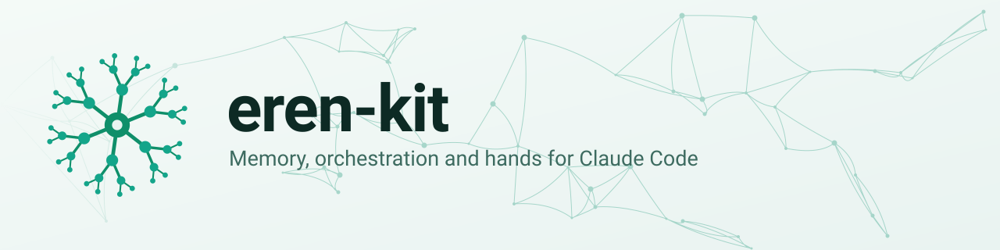
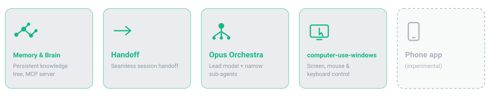
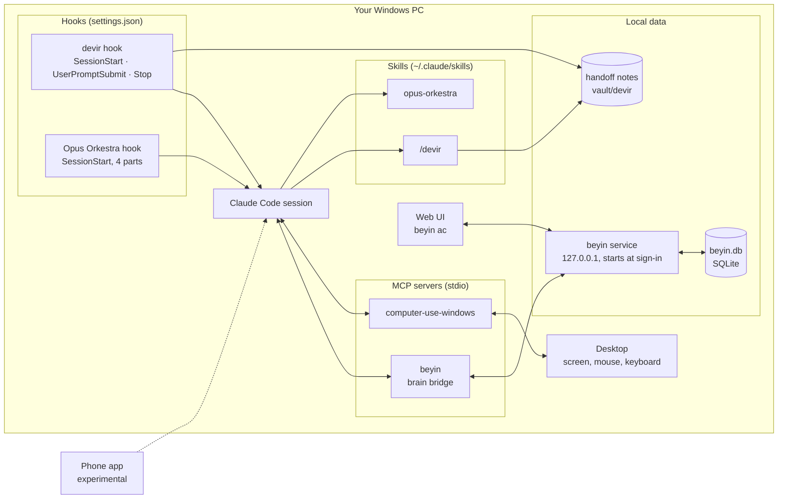

<div align="center">

<picture>
  <source media="(prefers-color-scheme: dark)" srcset="docs/assets/banner-dark.svg">
  
</picture>

**Memory, orchestration and hands for Claude Code.**

[](LICENSE)
[](#-quick-start)
[](packages/bellek/pyproject.toml)
[-5FA04E.svg)](apps/phone/package.json)
[](https://docs.claude.com/en/docs/claude-code/overview)
[](CHANGELOG.md)

English · [Türkçe](README.tr.md)

</div>

---

## 💡 Why

Claude Code is a strong pair programmer, but out of the box it forgets everything when a session
ends, does all the work inside one ever-growing context, and in the Windows CLI it cannot see or
use your screen. eren-kit is a personal toolkit that fills those three gaps: a local **memory**
that survives across sessions (plus handoff notes between them), an **orchestration** rule that
makes the lead model delegate to narrow sub-agents, and **hands** in the form of a Windows
computer-use MCP server. Everything runs on your machine, and one PowerShell script installs it.

> [!NOTE]
> eren-kit is **alpha** software, built for and tested on one person's Windows setup. Parts of the
> documentation and the Opus Orkestra rules are still in Turkish. Expect rough edges, and read
> what the installer will do with `-DryRun` first.

## 🧩 What's inside

<p align="center">
  
</p>

| Component | What it does | Type | Status |
| --- | --- | --- | --- |
| [**Memory & Brain**](#memory--brain-beyin) (`packages/bellek`) | Persistent, hierarchical knowledge tree about you and your work, exposed to Claude as the `beyin` MCP server, with a local web UI | MCP · CLI · Web UI | Working (alpha) |
| [**Handoff**](#handoff-devir) (`packages/bellek`) | Writes handoff notes so the next session can pick up where the last one stopped; warns about expensive long contexts | Hooks · Skill | Working (alpha) |
| [**Opus Orkestra**](#opus-orkestra) (`packages/opus-orkestra`) | Working rule: the lead model does not write code itself, it splits work across many narrow sub-agents and verifies the result | Skill · Hook | Working; rules in Turkish |
| [**computer-use-windows**](#computer-use-windows) (`packages/computer-use-windows`) | Screen, UI Automation, mouse and keyboard for terminal agents on Windows, with guard rails | MCP | Working (0.1.0) |
| [**Phone app**](#phone-app-experimental) (`apps/phone`) | Talk to the main Claude session on your PC from your phone | App | **Experimental**, not ready for use |

## 🏗️ Architecture



Claude Code talks to two local MCP servers over stdio. Hooks inject context at session start and
write handoff notes when a turn ends. The brain database has a single writer, a small service on
`127.0.0.1`; the MCP bridge and the web UI both go through it. The phone link (dashed) is
experimental.

## 🚀 Quick start

### Prerequisites

| Requirement | Needed for | Notes |
| --- | --- | --- |
| Windows 10 or 11 | everything | macOS and Linux are not supported yet |
| PowerShell | the installer | PowerShell 7 recommended; Windows PowerShell 5.1 also works |
| Python 3.12+ | Memory & Brain, Handoff | computer-use-windows and the installer need 3.11+ |
| `python` on `PATH`, 3.11+ | Handoff and Opus Orkestra hooks | The hooks call plain `python`, and the installer checks its version. Tick **"Add python.exe to PATH"** when installing Python |
| [Claude Code CLI](https://docs.claude.com/en/docs/claude-code/setup) (`claude`) | MCP registration | Without it the installer skips MCP steps and prints the manual command |
| Node 24+ and npm | Phone app only | Not needed for the default install |

### Install

```powershell
git clone https://github.com/SelmanBoray/eren-kit.git
cd eren-kit

.\install.ps1 -DryRun                    # optional: list what would change, change nothing
.\install.ps1 -AssistantName "Ada"       # install the default components
```

If the execution policy blocks the script:

```powershell
powershell -ExecutionPolicy Bypass -File .\install.ps1
```

Then:

1. **Restart Claude Code** so it picks up the new MCP servers, hooks and skills.
2. **Check the MCP servers:**

   ```powershell
   claude mcp list        # should list "beyin" and "computer-use-windows"
   ```

3. **Open the brain's web UI** (optional). The brain service already runs in the background: the
   installer registers it as a scheduled task and starts it right away.

   ```powershell
   packages\bellek\.venv\Scripts\beyin ac
   ```

4. **Optional: set your notes folder.** The installer copies `bellek.example.toml` to
   `packages\bellek\bellek.toml` if it does not exist yet. Edit `vault` there if you want handoff
   notes somewhere other than `packages\bellek\vault`.

### Pick components

The default set is `beyin, devir, orkestra, computer-use`. The phone app is installed only when you
ask for it.

```powershell
.\install.ps1 -Components beyin,devir          # memory + handoff only
.\install.ps1 -Components orkestra             # just the orchestration rule
.\install.ps1 -Components computer-use         # just the Windows computer-use server
.\install.ps1 -Components phone                # experimental phone app dependencies (npm ci)
```

Running the installer again is safe: it updates what changed and leaves the rest alone.

## 🛠️ `install.ps1` reference

```text
.\install.ps1 [-Components <list>] [-AssistantName <name>] [-ClaudeHome <folder>]
              [-DryRun] [-Uninstall] [-SkipMcp] [-NoService] [-ReplaceExisting] [-Help]
```

| Parameter | Description |
| --- | --- |
| `-Components` | Comma-separated component list, e.g. `-Components beyin,devir`. Valid: `beyin`, `devir`, `orkestra`, `computer-use`, `phone`. Default: `beyin, devir, orkestra, computer-use` |
| `-AssistantName` | Assistant name, written to the `EREN_KIT_ASSISTANT_NAME` user environment variable. If omitted, an existing value is kept; otherwise `"Claude"` |
| `-ClaudeHome` | Claude Code settings folder. Default: the `CLAUDE_CONFIG_DIR` environment variable if set, otherwise `%USERPROFILE%\.claude` |
| `-DryRun` | Changes nothing; lists what would be done |
| `-Uninstall` | Removes the selected components' MCP registrations, hooks, copied skills and the brain service task. Does **not** delete venvs or user data |
| `-SkipMcp` | Skips the `claude mcp add/remove` steps |
| `-NoService` | Does not install (or remove) the brain service's scheduled task; you manage the service yourself |
| `-ReplaceExisting` | Removes `settings.json` entries for older copies of the same hook scripts outside the repository (e.g. a `bellek\devir\hook.py` in another folder, `~\.claude\hooks\opus-orkestra-sessionstart.py`), with a backup. Without it they stay and the hooks run twice |
| `-Help` | Shows the built-in help (in Turkish) |

| Component | What the installer does |
| --- | --- |
| `beyin` | Creates `packages\bellek\.venv` and runs `pip install -e`; copies `bellek.example.toml` to `bellek.toml` if missing; checks that `bellek.beyin` imports; registers the `beyin` MCP server (user scope); registers and starts the brain service task (see below) |
| `devir` | Uses the same venv; checks that `python` on `PATH` is 3.11+; adds the handoff hook to `SessionStart`, `UserPromptSubmit` and `Stop`; copies the skill to `<ClaudeHome>\skills\devir` |
| `orkestra` | Checks that `python` on `PATH` is 3.11+; copies `SKILL.md` to `<ClaudeHome>\skills\opus-orkestra`; adds four `SessionStart` hook commands |
| `computer-use` | Creates `packages\computer-use-windows\.venv` and runs `pip install -e`; registers the `computer-use-windows` MCP server (user scope) |
| `phone` | Checks for Node 24+ and npm; runs `npm ci` in `apps\phone`. Nothing is registered; it is started by hand |

How it treats your existing setup:

- **`settings.json` is merged, not overwritten.** Your other settings and hooks are kept. eren-kit's
  hooks are recognised by their script path inside the repository, so re-running never adds them
  twice, and moving the repository updates the old entries. If nothing changes, the file is not
  touched.
- **Backups first.** Before changing `settings.json` or replacing a skill folder, the original is
  copied to `<ClaudeHome>\backups\eren-kit\<timestamp>\`.
- **MCP registrations** go to the `claude` CLI's own user configuration (independent of
  `-ClaudeHome`). An identical registration is left alone. A registration with the same name but a
  different command is backed up, then replaced; if the new one cannot be added, the old one is
  restored. If that registration points outside the repository, the installer says so, in
  `-DryRun` too.
- **Brain service task.** The `beyin` component registers a user-level Task Scheduler task named
  `eren-kit-beyin-servis` (no administrator rights needed). It runs
  `packages\bellek\.venv\Scripts\pythonw.exe -m bellek.beyin servis` silently at every sign-in and
  is started right after installation. Re-installing updates and restarts it;
  `-Uninstall -Components beyin` stops and removes it; `-NoService` skips this step. If another
  task already runs the same service, the installer warns you, since both would use the same port.
- **Copied skills** get a small `.eren-kit` marker file. `-Uninstall` only removes skill folders
  that carry this marker or match the repository copy, and backs them up first; anything else is
  left untouched. If a backup cannot be taken, nothing is deleted.

### Migrating from a manual setup

If you set up any of these pieces by hand before (for example the handoff hook from another
folder, or the Opus Orkestra hook under `~\.claude\hooks`), the installer adds its own entries and
warns that the old copies are still registered, so those hooks would run twice. To switch over:

```powershell
.\install.ps1 -DryRun -ReplaceExisting      # see which old entries would be replaced
.\install.ps1 -ReplaceExisting              # remove them (settings.json is backed up first)
```

`-ReplaceExisting` only touches hook entries in `settings.json`; it does not delete the old script
files. An existing `beyin` or `computer-use-windows` MCP registration is replaced (with a backup)
even without this switch, as described above; `-DryRun` shows it first.

### Uninstall

```powershell
.\install.ps1 -Uninstall                         # default components
.\install.ps1 -Uninstall -Components orkestra    # just one
```

This removes hooks, copied skills, the brain service task, and the MCP registrations that point
into this repository (a `beyin` or `computer-use-windows` registration pointing elsewhere is left
alone, with a warning). It keeps the venvs, `bellek.toml`, your
brain database, your notes and the `EREN_KIT_ASSISTANT_NAME` variable; delete those by hand if you
want them gone.

## 📦 Components

### Memory & Brain (`beyin`)

A hierarchical "brain map" about you: nodes with a title, summary and detail, append-only facts, an
inbox for suggestions without a clear place, and a change history, all in one SQLite file.

- **Six MCP tools:** `beyin_ara` (search), `beyin_gez` (browse a node and its children),
  `beyin_oku` (read a node), `beyin_yaz` (add a fact), `beyin_duzelt` (edit a summary/detail or
  retire a fact), `beyin_gelen` (list or decide inbox items).
- **Single writer.** A local service on `127.0.0.1` (default port `47321`) is the only process that
  writes the database. The installer runs it in the background at every sign-in (scheduled task
  `eren-kit-beyin-servis`). If it is not running, reads still work from a read-only connection and
  `beyin_yaz` writes are queued until the service starts.
- **Web UI.** `beyin ac` opens a read-mostly view in your browser that draws the brain as a glowing
  mycelium network growing over time. It can only write inbox decisions.
- **Guard rails.** Text that looks like a secret is rejected by `beyin_yaz`; nodes can be marked
  private.
- **Tool names and CLI are in Turkish** (`ara` = search, `gez` = browse, `oku` = read,
  `yaz` = write, `duzelt` = correct, `gelen` = inbox).

```powershell
# from the repository root
packages\bellek\.venv\Scripts\beyin ac         # open the web UI (needs the service running)
packages\bellek\.venv\Scripts\beyin ara "project deadlines"
packages\bellek\.venv\Scripts\bellek doktor    # health check of the install
```

If you installed with `-NoService` or by hand, start the service yourself and leave that terminal
open (or set up your own autostart):

```powershell
packages\bellek\.venv\Scripts\beyin servis
```

Example prompts in Claude Code:

- "What do you know about my current projects?"
- "Remember that I prefer small, frequent commits."
- "That deadline moved to Friday, update the brain."

Details: [packages/bellek/README.md](packages/bellek/README.md) (Turkish, with an English summary)
and the design contract [packages/bellek/DESIGN.md](packages/bellek/DESIGN.md).

### Handoff (`devir`)

Long sessions get expensive. Handoff lets you move to a fresh, short session without losing the
thread.

- **`Stop` hook:** writes one short automatic note per session.
- **`SessionStart` hook:** adds the session id and an index of recent notes to the new session's
  context.
- **`UserPromptSubmit` hook:** warns about cache re-write cost after a long pause and about very
  large contexts (it adds no text to the context).
- **`/devir` skill:** writes a rich handoff note on request, and helps the next session read it.
- **Fail-open:** on any error the hook prints nothing and never blocks the session.

Notes live under `BELLEK_DEVIR_DIR`, or by default in the `devir` folder inside your `vault`
(automatic notes in `devir\oto\`).

Example: type `/devir` before closing a session, then in the new one say *"continue from the last
handoff note"*.

Details: [packages/bellek/README.md](packages/bellek/README.md) and the skill
[packages/bellek/skills/devir/SKILL.md](packages/bellek/skills/devir/SKILL.md).

### Opus Orkestra

A working rule for coding sessions: the lead model does not write code itself. It splits the job
across many narrow sub-agents (Sonnet for simple, well-bounded work, Opus for complex work), sets
each one's limits, and verifies the result.

- **Why:** the lead's context stays on the plan and your intent; independent work runs in
  parallel; a reviewer with fresh context is not anchored on the author's assumptions.
- **Always on:** a `SessionStart` hook injects the rules at the start of every session. Claude Code
  caps hook context at 10,000 characters, so the text is split at `## ` headings and delivered by
  four hook commands (`--parca 1` to `--parca 4`).
- **Off switch:** ask the model to switch it off for a session, or remove it with
  `.\install.ps1 -Uninstall -Components orkestra`.
- **Language:** the rule text is currently Turkish. An English version is on the
  [roadmap](#-roadmap).

Details: [packages/opus-orkestra/README.md](packages/opus-orkestra/README.md) and the rules in
[packages/opus-orkestra/skill/SKILL.md](packages/opus-orkestra/skill/SKILL.md).

### computer-use-windows

Claude Code's built-in computer use is not available in the CLI on Windows. This MCP server brings
it to the agent in your terminal, built around two rules: **terminal first** and **token frugal**.

- **12 tools:** `screenshot`, `zoom`, `elements`, `windows`, `focus`, `click`, `type_text`, `key`,
  `scroll`, `drag`, `move`, `wait`.
- **Text before pixels.** `elements` reads the UI through Windows UI Automation; screenshots are
  downscaled to about 1.2k tokens by default; action tools never return images.
- **Guard rails.** It refuses to type into password fields and terminals, supports an app
  blocklist (`--block`), and has a failsafe: **move the mouse into a screen corner to stop it.**
- **Local only:** no network access, no telemetry.

Example prompts:

- "Open Settings and turn on Night light."
- "Start my app from `bin\Debug`, fill in the signup form and tell me whether Save enables."

Details, options and token-cost tables:
[packages/computer-use-windows/README.md](packages/computer-use-windows/README.md).

### Phone app (experimental)

> [!WARNING]
> This is a work in progress and **not ready for use**. Interfaces, protocol and security model may
> change. The test server has no authentication: never expose it to a network you do not trust.

The goal: talk from your phone to the main Claude session on your PC. The main session does not do
the work itself; it opens a fresh Claude Code session for each task, shows you a plan to approve,
and reports the result back. The directory currently holds the shared protocol, the PC service
design with tests, and a standalone measurement experiment.

Details (Turkish, with an English summary): [apps/phone/README.md](apps/phone/README.md).

### Manual installation

<details>
<summary>Install components by hand instead of using <code>install.ps1</code></summary>

The commands below assume you are in the repository root.

**Memory & Brain**

```powershell
cd packages\bellek
py -3.12 -m venv .venv
.venv\Scripts\python -m pip install -e .
Copy-Item bellek.example.toml bellek.toml        # then edit the paths
.venv\Scripts\bellek doktor
claude mcp add beyin -s user -- "$PWD\.venv\Scripts\python.exe" -m bellek.beyin mcp
.venv\Scripts\beyin servis                       # brain service; keep this terminal open
```

Without the installer there is no scheduled task, so start `beyin servis` yourself (or with your
own Task Scheduler entry) whenever you want writes applied and the web UI available.

**Handoff**

Copy `packages\bellek\skills\devir` to `~\.claude\skills\devir`, then add this command to the
`SessionStart`, `UserPromptSubmit` and `Stop` events in `~\.claude\settings.json` (replace `<repo>`
with the repository path; `|| true` keeps a failing hook from blocking the session):

```text
python -I "<repo>/packages/bellek/src/bellek/devir/hook.py" || true
```

**Opus Orkestra**

Copy `packages\opus-orkestra\skill\SKILL.md` to `~\.claude\skills\opus-orkestra\SKILL.md` and add
the four `SessionStart` commands shown in
[packages/opus-orkestra/README.md](packages/opus-orkestra/README.md#install).

**computer-use-windows**

```powershell
cd packages\computer-use-windows
python -m venv .venv
.venv\Scripts\python -m pip install -e .
claude mcp add computer-use-windows -s user -- "$PWD\.venv\Scripts\computer-use-windows.exe"
```

It can also run without cloning, through `uvx`; see
[packages/computer-use-windows/README.md](packages/computer-use-windows/README.md#alternative-uvx-without-cloning).

</details>

## ⚙️ Configuration

### Environment variables

| Variable | Used by | Default | Meaning |
| --- | --- | --- | --- |
| `CLAUDE_CONFIG_DIR` | installer | `%USERPROFILE%\.claude` | Claude Code's settings folder; the installer uses it as the default for `-ClaudeHome` |
| `EREN_KIT_ASSISTANT_NAME` | brain web UI, phone app | `Claude` | Display name of the assistant. Set by `-AssistantName`. It does not rename Claude inside Claude Code |
| `BELLEK_CONFIG` | Memory & Brain, Handoff | `packages\bellek\bellek.toml` | Path of the config file |
| `BELLEK_BEYIN_DB` | Memory & Brain | `%LOCALAPPDATA%\Bellek\beyin.db` | Brain database |
| `BELLEK_BEYIN_PORT` | Memory & Brain | `47321` | Port of the local brain service |
| `BELLEK_BEYIN_IZINLI_HOST` | Memory & Brain | empty | Extra `Host` values the service accepts (comma-separated), for access from another device |
| `BELLEK_DEVIR_DIR` | Handoff | `<vault>\devir` | Root folder of handoff notes |
| `BELLEK_DEVIR_UYARI` | Handoff | `durdur` | Warning mode: `durdur` (stop), `uyar` (warn), `kapali` (off) |
| `OPUS_ORKESTRA_SKILL` | Opus Orkestra | `~\.claude\skills\opus-orkestra\SKILL.md` | Path of the rule file the hook injects |
| `CUW_MAX_SIZE`, `CUW_BLOCK`, `CUW_FAILSAFE`, … | computer-use-windows | see package README | Image size, app blocklist, failsafe and more ([full table](packages/computer-use-windows/README.md#configuration)) |

The brain also has variables for its log, queue and token files; see the
[bellek README](packages/bellek/README.md#ortam-değişkenleri).

### `bellek.toml`

[`packages/bellek/bellek.example.toml`](packages/bellek/bellek.example.toml) is the template; the
installer copies it to `packages\bellek\bellek.toml`, which is git-ignored. The main keys:

```toml
[bellek]
vault = "vault"                        # your notes folder; handoff notes go to vault/devir
state_dir = "%LOCALAPPDATA%/Bellek"    # indexes and logs, kept out of the vault

[server]
host = "127.0.0.1"                     # local only
port = 47321
```

You can also add read-only note sources (`[[source]]`) and map folders to project names
(`[projects]`); the template explains both.

## 🔒 Privacy & safety

- **Your data stays local.** The brain database, notes, logs and tokens live under
  `%LOCALAPPDATA%\Bellek` and your vault folder. The brain service listens on `127.0.0.1` only.
- **Nothing personal goes into the repository.** `bellek.toml`, `vault/`, eval data, databases,
  `.env` files and keys are listed in [`.gitignore`](.gitignore).
- **Mind the model provider.** Whatever a tool returns (brain entries, screenshots, screen text)
  becomes part of your Claude session and is sent to your model provider like the rest of it.
- **computer-use-windows controls your real mouse and keyboard.** It will not type into password
  fields or terminals, it honours an app blocklist, and moving the mouse into a screen corner stops
  every action. Don't use the PC while it works, close sensitive windows, and type passwords
  yourself.
- **Hooks are fail-open.** A broken hook prints nothing and never blocks your session.
- **Reporting a vulnerability:** see [SECURITY.md](SECURITY.md).

## 🗂️ Repository layout

```text
eren-kit/
├── install.ps1                    # one-command installer (run with -Help)
├── scripts/installer/             # installer module and settings.json hook merger
├── packages/
│   ├── bellek/                    # Memory & Brain + Handoff (Python 3.12+)
│   │   ├── src/bellek/            #   core, beyin (brain), devir (handoff)
│   │   ├── skills/devir/          #   /devir skill
│   │   ├── eval/                  #   retrieval evaluation set
│   │   └── bellek.example.toml    #   config template
│   ├── opus-orkestra/             # orchestration rule
│   │   ├── skill/SKILL.md         #   the rules (Turkish)
│   │   └── hooks/                 #   SessionStart hook
│   └── computer-use-windows/      # Windows computer-use MCP server (Python 3.11+)
├── apps/
│   └── phone/                     # experimental phone app (Node 24+, TypeScript)
├── docs/assets/                   # banner and diagrams
└── .github/workflows/ci.yml       # tests on windows-latest
```

## 🧭 Roadmap

Honest list of what is missing, in no particular order:

- [ ] **English Opus Orkestra rules** (currently Turkish only).
- [ ] **A usable phone app:** the client app, authentication and pairing are not done yet.
- [ ] **macOS and Linux support.** Today everything assumes Windows; computer-use-windows is
      Windows-only by design.
- [ ] **One-line install with `uvx`** for the whole kit (today only computer-use-windows can run
      through `uvx`).
- [ ] More English documentation for the `bellek` package.

## 🤝 Contributing

Issues and pull requests are welcome. [CONTRIBUTING.md](CONTRIBUTING.md) explains how to run each
package's tests; CI runs them on Windows for every pull request. Please never commit personal data
or secrets, and read the assistant name from `EREN_KIT_ASSISTANT_NAME` instead of hard-coding one.
Changes are tracked in [CHANGELOG.md](CHANGELOG.md).

## 📄 License

[MIT](LICENSE) © 2026 SelmanBoray

Not affiliated with or endorsed by Anthropic.
