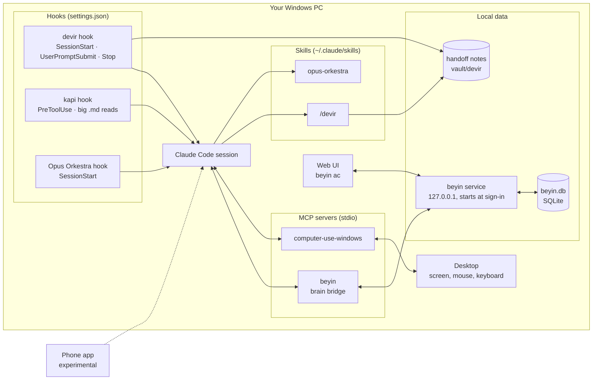
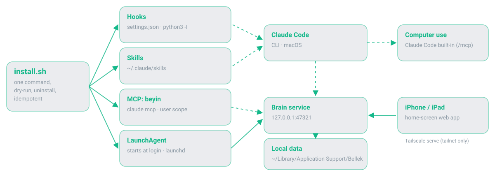

<div align="center">

<picture>
  <source media="(prefers-color-scheme: dark)" srcset="docs/assets/banner-dark.svg">
  
</picture>

**Memory, orchestration and hands for Claude Code.**

[](https://github.com/SelmanBoray/eren-kit/actions/workflows/ci.yml)
[](LICENSE)
[](#-quick-start)
[](packages/bellek/pyproject.toml)
[-5FA04E.svg)](apps/phone/package.json)
[](https://docs.claude.com/en/docs/claude-code/overview)
[](CHANGELOG.md)

English · [Türkçe](README.tr.md)

</div>

---

Claude Code forgets you when a session ends, does every job inside one ever-growing context, and
in the Windows CLI it cannot see your screen. **eren-kit fixes all three, on your own machine:** a
local brain that Claude searches and updates across sessions, a rule that turns the lead model into
a planner that hands work to narrow sub-agents, and an MCP server that gives it eyes and hands on
the Windows desktop. One PowerShell script installs it; `-DryRun` shows every change first and
`-Uninstall` takes it back out.

<div align="center">

**[Quick start](#-quick-start)** · [What's inside](#-whats-inside) · [Components](#-components) · [Privacy & safety](#-privacy--safety) · [Security policy](SECURITY.md)

</div>

## ✨ Before and after

| Claude Code on its own | With eren-kit |
| --- | --- |
| Every session starts from zero: who you are, what you are building, what you decided last week. | **[Memory & Brain](#memory--brain-beyin)** keeps a knowledge tree about you and your work in one local SQLite file. Claude reaches it through six MCP tools, so *"What do you know about my current projects?"* gets an answer from your own notes. |
| A long session gets slow and expensive, and starting a fresh one loses the thread. | **[Handoff](#handoff-devir)** writes a short note when a session ends and lists recent notes when the next one starts. `/devir` writes a rich note on request. |
| Agents page through big design docs 275-280 lines at a time, again and again. | **[Doc gate](#doc-gate-kapi)** answers the first read of a Markdown file of 16 KB or more with a heading map (line ranges and sizes), so the agent reads only the section it needs. |
| The lead model reads, writes and tests everything itself, and its context fills up with file dumps. | **[Opus Orkestra](#opus-orkestra)** makes it a planner: narrow sub-agents work in parallel, a reviewer with fresh context checks the result, and the lead verifies. Its default core rule adds about 4 KB of context per session instead of about 35 KB for the full rule book. |
| In the Windows CLI there is no computer use. | **[computer-use-windows](#computer-use-windows)** adds 12 MCP tools for screen, UI Automation, mouse and keyboard. It reads the UI as text before it looks at pixels; a default screenshot costs about 1.2k tokens. |

Also in the box, and clearly labelled experimental: a [phone app](#phone-app-experimental) for
talking to your main Claude Code session on the PC.

## 🧩 What's inside

<p align="center">
  
</p>

| Component | What it does | Type | Status |
| --- | --- | --- | --- |
| [**Memory & Brain**](#memory--brain-beyin) (`packages/bellek`) | Persistent, hierarchical knowledge tree about you and your work, exposed to Claude as the `beyin` MCP server, with a local web UI | MCP · CLI · Web UI | Working (alpha) |
| [**Handoff**](#handoff-devir) (`packages/bellek`) | Writes handoff notes so the next session can pick up where the last one stopped; warns about expensive long contexts | Hooks · Skill | Working (alpha) |
| [**Doc gate**](#doc-gate-kapi) (`packages/bellek`) | Map-first gate: the first read of a big Markdown file (16 KB+) is refused with a heading map, so agents read only the section they need | Hook | Working (alpha) |
| [**Opus Orkestra**](#opus-orkestra) (`packages/opus-orkestra`) | Working rule: the lead model does not write code itself, it splits work across many narrow sub-agents and verifies the result | Skill · Hook | Working; rules in Turkish |
| [**computer-use-windows**](#computer-use-windows) (`packages/computer-use-windows`) | Screen, UI Automation, mouse and keyboard for terminal agents on Windows, with guard rails | MCP | Working (0.1.0) |
| [**Phone app**](#phone-app-experimental) (`apps/phone`) | Talk to the main Claude session on your PC from your phone | App | **Experimental**, not ready for use |

## 🔍 Built to be checked

- **Local by default.** The brain service listens on `127.0.0.1` only and checks the `Host`
  header, the `Origin` header and a per-install token on its API. The brain, the hooks and
  computer-use-windows send no telemetry and call no cloud or embedding API; what reaches your
  model provider is what Claude reads in your session.
- **An installer you can read before you run it.** No `irm | iex`, no administrator rights (the
  brain service is a user-level scheduled task). `-DryRun` lists every change, `settings.json` is
  merged rather than overwritten, everything is backed up before it is changed, re-running is
  safe, and `-Uninstall` removes only what eren-kit installed. A read-only
  [doctor](#installation-doctor) checks the wiring afterwards.
- **Fail-open hooks.** If a hook breaks, it prints nothing and your session carries on.
- **Tested.** More than 4,000 automated tests across the Python, TypeScript and Kotlin parts. CI
  runs them on every pull request, on Windows (the Kotlin core on Linux), and again on macOS for
  the brain, Opus Orkestra and the installer.
- **Honest about limits.** [SECURITY.md](SECURITY.md) lists what eren-kit does not protect you
  from, and the [roadmap](#-roadmap) lists what is missing.

> [!NOTE]
> eren-kit is **alpha** software. It grew out of one person's daily Windows setup and has been
> tested there, not across many machines. Parts of the documentation and the Opus Orkestra rules
> are still in Turkish. Expect rough edges, and run the installer with `-DryRun` first.

## 🚀 Quick start

### Prerequisites

| Requirement | Needed for | Notes |
| --- | --- | --- |
| Windows 10 or 11 | everything | On macOS use `install.sh`, see [macOS & iOS](#-macos--ios). Linux is not supported yet |
| PowerShell | the installer | PowerShell 7 recommended; Windows PowerShell 5.1 also works |
| Python 3.12+ | Memory & Brain, Handoff | computer-use-windows and the installer need 3.11+ |
| `python` on `PATH`, 3.11+ | Handoff, doc gate and Opus Orkestra hooks | The hooks call plain `python`, and the installer checks its version. Tick **"Add python.exe to PATH"** when installing Python |
| [Claude Code CLI](https://docs.claude.com/en/docs/claude-code/setup) (`claude`) | MCP registration | Without it the installer skips MCP steps and prints the manual command |
| Node 24+ and npm | Phone app only | Not needed for the default install |

### Install

Clone into your user folder (for example `%USERPROFILE%\eren-kit`), not directly under `C:\`:
folders under `C:\` are writable by every local account, and the hooks run their code as you.

```powershell
cd $env:USERPROFILE
git clone https://github.com/SelmanBoray/eren-kit.git
cd eren-kit

.\install.ps1 -DryRun                    # optional: list what would change, change nothing
.\install.ps1 -AssistantName "Ada"       # install the default components
```

If the execution policy blocks the script:

```powershell
powershell -ExecutionPolicy Bypass -File .\install.ps1
```

Then:

1. **Restart Claude Code** so it picks up the new MCP servers, hooks and skills.
2. **Check the MCP servers:**

   ```powershell
   claude mcp list        # should list "beyin" and "computer-use-windows"
   ```

3. **Open the brain's web UI** (optional). The brain service already runs in the background: the
   installer registers it as a scheduled task and starts it right away.

   ```powershell
   packages\bellek\.venv\Scripts\beyin ac
   ```

4. **Optional: set your notes folder.** The installer copies `bellek.example.toml` to
   `packages\bellek\bellek.toml` if it does not exist yet. Edit `vault` there if you want handoff
   notes somewhere other than `packages\bellek\vault`.

### Pick components

The default set is `beyin, devir, kapi, orkestra, computer-use`. The phone app is installed only when you
ask for it.

```powershell
.\install.ps1 -Components beyin,devir          # memory + handoff only
.\install.ps1 -Components kapi                 # just the doc gate hook
.\install.ps1 -Components orkestra             # just the orchestration rule
.\install.ps1 -Components computer-use         # just the Windows computer-use server
.\install.ps1 -Components phone                # experimental phone app dependencies (npm ci)
```

Running the installer again is safe: it updates what changed and leaves the rest alone. Only want
the computer-use server? It also runs without cloning, through `uvx`; see
[its README](packages/computer-use-windows/README.md#alternative-uvx-without-cloning).

**Upgrading an existing install:** `git pull`, then run `.\install.ps1` again (at least
`.\install.ps1 -Components beyin`). This replaces an older `beyin` MCP registration with the current
one, which starts Python with `-I` so that no code is loaded from the folder Claude Code was opened
in.

## 🏗️ Architecture



Claude Code talks to two local MCP servers over stdio. Hooks inject context at session start and
write handoff notes when a turn ends. The brain database has a single writer, a small service on
`127.0.0.1`; the MCP bridge and the web UI both go through it. The phone link (dashed) is
experimental.

## 🍎 macOS & iOS

<p align="center">
  
</p>

On macOS, `install.sh` does what `install.ps1` does on Windows, with the same rules: it merges
`settings.json` instead of overwriting it, backs up everything it changes, is safe to re-run, and
removes only what it installed.

```bash
git clone https://github.com/SelmanBoray/eren-kit.git && cd eren-kit
./install.sh --dry-run                    # list what would change, change nothing
./install.sh --assistant-name "Ada"       # install beyin, devir, kapi, orkestra
./install.sh --uninstall                  # remove them again (venvs and your data stay)
```

Needs Python 3.12+ (`brew install python@3.13`) and the Claude Code CLI. Flags mirror the Windows
installer: `--components`, `--claude-home`, `--skip-mcp`, `--no-service`, `--keep-existing`
(`--replace-existing` is still accepted but no longer needed), `--doctor` and `--json` (see
[Installation doctor](#installation-doctor)), plus `--tailscale-host` (see below).

| | Windows | macOS |
| --- | --- | --- |
| Brain service | Task Scheduler task at logon | LaunchAgent `com.eren-kit.beyin-servis` (`~/Library/LaunchAgents`), restarts on crash, log in `~/Library/Logs/eren-kit` |
| Local data | `%LOCALAPPDATA%\Bellek` | `~/Library/Application Support/Bellek` |
| Hook interpreter | `python` on `PATH` | absolute path of a Python 3.11+ (`python` usually does not exist on macOS) |
| Assistant name | user environment variable | `env` block of `settings.json` and the service plist |
| Computer use | `computer-use-windows` MCP | Claude Code's [built-in computer use](https://code.claude.com/docs/en/computer-use): in a session run `/mcp`, pick `computer-use`, **Enable** (Pro/Max, interactive sessions) |

<p align="center"></p>
<p align="center"><sub>The brain web UI on macOS (sample data).</sub></p>

**iPhone and iPad.** The brain's web UI works in mobile Safari and can be added to the home screen
as an app (it ships a web manifest and icon). Expose it to your own devices only, over your tailnet:

```bash
tailscale serve --bg --http 80 http://127.0.0.1:47321
./install.sh --components beyin --tailscale-host "<mac>.<tailnet>.ts.net"
packages/bellek/.venv/bin/beyin ac --yazdir --taban "http://<mac>.<tailnet>.ts.net"
```

Open the printed address on the phone, then Share → **Add to Home Screen**. The home-screen app has
its own storage, so on its first launch paste the same address (or just the key) into the field on
the sign-in screen; it is remembered for that app only. In a normal browser tab the key still lasts
only for the session. Nothing is opened to the internet: no funnel, and the service still binds to
`127.0.0.1`.


## 🛠️ `install.ps1` reference

```text
.\install.ps1 [-Components <list>] [-AssistantName <name>] [-ClaudeHome <folder>]
              [-DryRun] [-Uninstall] [-SkipMcp] [-NoService] [-KeepExisting] [-Help]
.\install.ps1 -Doctor [-Json] [-ClaudeHome <folder>]
```

<details>
<summary>All parameters, and what each component installs</summary>

| Parameter | Description |
| --- | --- |
| `-Components` | Comma-separated component list, e.g. `-Components beyin,devir`. Valid: `beyin`, `devir`, `kapi`, `orkestra`, `computer-use`, `phone`. Default: `beyin, devir, kapi, orkestra, computer-use` |
| `-AssistantName` | Assistant name, written to the `EREN_KIT_ASSISTANT_NAME` user environment variable. If omitted, an existing value is kept; otherwise `"Claude"` |
| `-ClaudeHome` | Claude Code settings folder. Default: the `CLAUDE_CONFIG_DIR` environment variable if set, otherwise `%USERPROFILE%\.claude` |
| `-DryRun` | Changes nothing; lists what would be done |
| `-Uninstall` | Removes the selected components' MCP registrations, hooks, copied skills and the brain service task. Does **not** delete venvs or user data |
| `-SkipMcp` | Skips the `claude mcp add/remove` steps |
| `-NoService` | Does not install (or remove) the scheduled tasks: neither the brain service task nor, for the `phone` component, its task (on uninstall the phone task is not deleted); you manage the services yourself |
| `-KeepExisting` | Keeps `settings.json` entries for older copies of the same hook scripts outside the repository (e.g. a `bellek\devir\hook.py` in another folder, `~\.claude\hooks\opus-orkestra-sessionstart.py`, or an older doc gate registration). By default these are replaced by the new registration, after a backup; with this switch the old ones stay and those hooks run twice. Cannot be combined with `-ReplaceExisting` |
| `-ReplaceExisting` | Kept for compatibility: replacing old copies is now the default, so this switch is no longer needed |
| `-Doctor` | Installs nothing; runs only the [installation doctor](#installation-doctor) and exits with its exit code. `-ClaudeHome` is passed on to it |
| `-Json` | With `-Doctor`: prints the doctor's result as JSON |
| `-Help` | Shows the built-in help (in Turkish) |

| Component | What the installer does |
| --- | --- |
| `beyin` | Creates `packages\bellek\.venv` and runs `pip install -e`; copies `bellek.example.toml` to `bellek.toml` if missing; checks that `bellek.beyin` imports; registers the `beyin` MCP server (user scope, `python -I -m bellek.beyin mcp`); registers and starts the brain service task (see below) |
| `devir` | Uses the same venv; checks that `python` on `PATH` is 3.11+; adds the handoff hook to `SessionStart`, `UserPromptSubmit` and `Stop`; copies the skill to `<ClaudeHome>\skills\devir` |
| `kapi` | Checks that `python` on `PATH` is 3.11+; adds the doc gate hook to `PreToolUse` for Markdown reads and to `SessionStart` (`compact` matcher). No venv, no skill |
| `orkestra` | Checks that `python` on `PATH` is 3.11+; copies `SKILL.md` to `<ClaudeHome>\skills\opus-orkestra`; adds four `SessionStart` hook commands |
| `computer-use` | Creates `packages\computer-use-windows\.venv` and runs `pip install -e`; registers the `computer-use-windows` MCP server (user scope) |
| `phone` | Checks for Node 24+ and npm; runs `npm ci` in `apps\phone`. Nothing is registered; it is started by hand |

</details>

How it treats your existing setup:

- **`settings.json` is merged, not overwritten.** Your other settings and hooks are kept. eren-kit's
  hooks are recognised by their script path inside the repository, so re-running never adds them
  twice, and moving the repository updates the old entries. If nothing changes, the file is not
  touched.
- **Backups first.** Before changing `settings.json` or replacing a skill folder, the original is
  copied to `<ClaudeHome>\backups\eren-kit\<timestamp>\`. Backups are plain-text copies (including
  MCP `env` values, which may hold tokens); `-Uninstall` never deletes them. Delete the folder when
  no longer needed and keep it out of any dotfiles repository.
- **MCP registrations** go to the `claude` CLI's own user configuration (independent of
  `-ClaudeHome`). An identical registration is left alone. A registration with the same name but a
  different command is backed up, then replaced; if the new one cannot be added, the old one is
  restored. Arguments you added yourself (for example a computer-use `--block` list) and `env`
  values are carried over to the new registration unchanged: the registration goes to
  `claude mcp add-json` as one escaped JSON argument, so no value is read as a command, and the
  output shows only how many arguments and which `env` names were carried, not their values. A
  registration that cannot be carried over exactly is not carried, and the installer says so. If
  that registration points outside the repository, the installer says so, in `-DryRun` too.
- **Brain service task.** The `beyin` component registers a user-level Task Scheduler task named
  `eren-kit-beyin-servis` (no administrator rights needed). It runs
  `packages\bellek\.venv\Scripts\pythonw.exe -I -m bellek.beyin servis` silently at every sign-in
  and is started right after installation. Re-installing updates and restarts it;
  `-Uninstall -Components beyin` stops and removes it; `-NoService` skips this step. If another
  task already runs the same service, the installer warns you, since both would use the same port.
- **Copied skills** get a small `.eren-kit` marker file. `-Uninstall` only removes skill folders
  that carry this marker or match the repository copy, and backs them up first; anything else is
  left untouched. If a backup cannot be taken, nothing is deleted.

### Migrating from a manual setup

If you set up any of these pieces by hand before (for example the handoff hook from another
folder, or the Opus Orkestra hook under `~\.claude\hooks`), the switch-over happens by itself: the
installer replaces the old registrations of the same component with its own, after backing up
`settings.json`. Re-running never doubles the hooks.

```powershell
.\install.ps1 -DryRun                       # see what would change first
.\install.ps1                               # install; old registrations are replaced (backed up first)
.\install.ps1 -KeepExisting                 # deliberately keep the old registrations (those hooks run twice)
```

The replacement only touches hook entries in `settings.json`; it does not delete the old script
files. `-ReplaceExisting` is still accepted but no longer needed. An existing `beyin` or
`computer-use-windows` MCP registration is replaced (with a backup) as described above; `-DryRun`
shows it first.

### Uninstall

```powershell
.\install.ps1 -Uninstall                         # default components
.\install.ps1 -Uninstall -Components orkestra    # just one
```

This removes hooks, copied skills, the brain service task (removing the `phone` component also
deletes its `eren-kit-telefon` scheduled task), and the MCP registrations that point
into this repository (a `beyin` or `computer-use-windows` registration pointing elsewhere is left
alone, with a warning). It keeps the venvs, `bellek.toml`, your
brain database, your notes, the installer's backups and the `EREN_KIT_ASSISTANT_NAME` variable;
delete those by hand if you want them gone.

### Installation doctor

`python scripts/installer/doktor.py` (or `.\install.ps1 -Doctor`, `./install.sh --doctor`) checks,
read-only, that the installed components are wired into Claude Code correctly: hook registrations
(duplicates, stale locations, missing events, script path), whether the installed skill copies
match the repo, MCP registrations, and the brain service and its task. It also flags unsafe MCP
registrations (a `-m` or `-c` Python launch without `-I`/`-P`, or a relative script path) and a
repository folder that other accounts can write to. `--json` gives machine output, `--no-network`
skips live system queries and external processes. Exit code: 0 no problems, 1 warnings, 2 errors.
A component that is not installed is not an error. The installer runs it once at the end of a real
install.

## 📦 Components

### Memory & Brain (`beyin`)

A hierarchical "brain map" about you: nodes with a title, summary and detail, append-only facts, an
inbox for suggestions without a clear place, and a change history, all in one SQLite file.

- **Six MCP tools:** `beyin_ara` (search), `beyin_gez` (browse a node and its children),
  `beyin_oku` (read a node), `beyin_yaz` (add a fact), `beyin_duzelt` (edit a summary/detail or
  retire a fact), `beyin_gelen` (list or decide inbox items).
- **Single writer.** A local service on `127.0.0.1` (default port `47321`) is the only process that
  writes the database. The installer runs it in the background at every sign-in (scheduled task
  `eren-kit-beyin-servis`). If it is not running, reads still work from a read-only connection and
  `beyin_yaz` writes are queued until the service starts.
- **Web UI.** `beyin ac` opens a read-mostly view in your browser that draws the brain as a glowing
  mycelium network growing over time. It can only write inbox decisions.
- **Guard rails.** Text that looks like a secret is rejected by `beyin_yaz`; nodes can be marked
  private.
- **Claude writes on its own.** The MCP server tells Claude to record lasting new facts about you
  in the same turn, without asking first. Review what it wrote in the web UI; see
  [SECURITY.md](SECURITY.md) for why this matters.
- **Tool names and CLI are in Turkish** (`ara` = search, `gez` = browse, `oku` = read,
  `yaz` = write, `duzelt` = correct, `gelen` = inbox).

```powershell
# from the repository root
packages\bellek\.venv\Scripts\beyin ac         # open the web UI (needs the service running)
packages\bellek\.venv\Scripts\beyin ara "project deadlines"
packages\bellek\.venv\Scripts\bellek doktor    # health check of the install (also checks the brain database)
```

Backup and restore (run from the same venv; the commands are `python -m bellek.beyin ...`):

```powershell
python -m bellek.beyin yedekle [--dizin D] [--sakla N]   # back up the brain database
python -m bellek.beyin yedekler                          # list backups
python -m bellek.beyin yedek-durum                       # show the state of the latest backup
python -m bellek.beyin geri-yukle <backup> [--evet]      # restore (asks first unless --evet)
python -m bellek.beyin ice-al --uzerine-yaz              # re-import the seed, overwriting corrected nodes
```

A backup is an online-consistent copy made with SQLite's backup API; the newest 14 are kept. Restore
only runs while the service is stopped, and the old database is set aside, not deleted. Local
backups are not encrypted. While the service is running, the brain takes a local backup by itself once a day; the installer's doctor (`beyin:yedek`) warns when there is no backup or the latest one is stale. A plain re-import (`ice-al`) keeps nodes you corrected after seeding;
`--uzerine-yaz` overwrites them too.

If you installed with `-NoService` or by hand, start the service yourself and leave that terminal
open (or set up your own autostart):

```powershell
packages\bellek\.venv\Scripts\beyin servis
```

Example prompts in Claude Code:

- "What do you know about my current projects?"
- "Remember that I prefer small, frequent commits."
- "That deadline moved to Friday, update the brain."

Details: [packages/bellek/README.md](packages/bellek/README.md) (Turkish, with an English summary)
and the design contract [packages/bellek/DESIGN.md](packages/bellek/DESIGN.md).

### Handoff (`devir`)

Long sessions get expensive. Handoff lets you move to a fresh, short session without losing the
thread.

- **`Stop` hook:** writes one short automatic note per session.
- **`SessionStart` hook:** adds the session id and an index of recent notes to the new session's
  context.
- **`UserPromptSubmit` hook:** warns about cache re-write cost after a long pause and about very
  large contexts (it adds no text to the context).
- **`/devir` skill:** writes a rich handoff note on request, and helps the next session read it.
- **Fail-open:** on any error the hook prints nothing and never blocks the session.
- **Housekeeping:** automatic notes older than 28 days are deleted at `SessionStart`. A prompt that
  starts with `/devir` is not caught by the whitespace guard.

Notes live under `BELLEK_DEVIR_DIR`, or by default in the `devir` folder inside your `vault`
(automatic notes in `devir\oto\`). Automatic notes quote short excerpts of the session's first and
last prompt in plain text.

Example: type `/devir` before closing a session, then in the new one say *"continue from the last
handoff note"*.

Details: [packages/bellek/README.md](packages/bellek/README.md) and the skill
[packages/bellek/skills/devir/SKILL.md](packages/bellek/skills/devir/SKILL.md).

### Doc gate (`kapi`)

A map-first gate for big Markdown files. Agents (the main session and sub-agents alike) tended to
read large project documents again and again in 275-280 line chunks; the gate makes them look at
the map first.

- **How it works:** a `PreToolUse` hook (`packages/bellek/src/bellek/kapi/hook.py`). The first time
  an agent touches a Markdown file of 16 KB or more, the read is refused and the reason carries a
  heading map: each heading's line range and size. The agent then reads only the section it needs,
  with `offset` / `limit`.
- **Never locks:** targeted reads of 80 lines or fewer pass, and a second attempt always passes.
- **Fail-open:** on any error the hook lets the read through.
- **No wasted processes:** the hook is registered with an `if` filter (`Read(//**/*.md)`,
  `Read(//**/*.markdown)`), so no process starts for other reads.
- **Off switch:** set the environment variable `BELLEK_KAPI=kapali`, or remove it with
  `.\install.ps1 -Uninstall -Components kapi`.
- **After compaction:** the map is shown again after a context compaction (compact); the installer
  also registers the gate on `SessionStart` with the `compact` matcher.
- **Measurement log:** `%LOCALAPPDATA%\Bellek\kapi\kapi.jsonl`.

### Opus Orkestra

A working rule for coding sessions: the lead model does not write code itself. It splits the job
across many narrow sub-agents (Sonnet for simple, well-bounded work, Opus for complex work), sets
each one's limits, and verifies the result.

- **Why:** the lead's context stays on the plan and your intent; independent work runs in
  parallel; a reviewer with fresh context is not anchored on the author's assumptions.
- **Always on, and small:** a `SessionStart` hook injects a short core rule
  ([`skill/CEKIRDEK.md`](packages/opus-orkestra/skill/CEKIRDEK.md)) at the start of every session,
  about 4 KB of context instead of about 35 KB for the full rule book. The full rules are read
  section by section when a code task starts. Set `OPUS_ORKESTRA_MOD=tam` to inject the full rules
  instead; since Claude Code caps hook context at 10,000 characters, they are split at `## `
  headings across the four hook commands (`--parca 1` to `--parca 4`).
- **Context ledger (`defter`):** per-repository summary cards kept inside git, so an agent reads a
  file's summary plus only what changed since. It does not record files outside the repository,
  inside `.git` or ignored by git (such as `.env`), and it does not run external commands from the
  repository's git configuration (external diff, textconv, filters, fsmonitor, hooks).
- **Off switch:** ask the model to switch it off for a session, or remove it with
  `.\install.ps1 -Uninstall -Components orkestra`.
- **Language:** the rule text is currently Turkish. An English version is on the
  [roadmap](#-roadmap).

Details: [packages/opus-orkestra/README.md](packages/opus-orkestra/README.md) and the rules in
[packages/opus-orkestra/skill/SKILL.md](packages/opus-orkestra/skill/SKILL.md).

### computer-use-windows

Claude Code's built-in computer use is not available in the CLI on Windows. This MCP server brings
it to the agent in your terminal, built around two rules: **terminal first** and **token frugal**.

- **12 tools:** `screenshot`, `zoom`, `elements`, `windows`, `focus`, `click`, `type_text`, `key`,
  `scroll`, `drag`, `move`, `wait`.
- **Text before pixels.** `elements` reads the UI through Windows UI Automation; screenshots are
  downscaled to about 1.2k tokens by default; action tools never return images.
- **Guard rails.** It refuses to type into password fields and terminals, supports an app
  blocklist (`--block`), and has a failsafe: **move the mouse into a screen corner to stop it.**
  The blocklist is empty until you set it, and the installer doesn't ask for one; see the package
  README's ["Recommended setup"](packages/computer-use-windows/README.md#recommended-setup).
  Driven through Win+R or a file dialog, it can start programs outside Claude Code's Bash
  permission rules and sandbox.
- **Local only:** no network access, no telemetry.
- **Safety checks:** typing re-checks the password-field / terminal / blocked-app rules after every
  Tab or Enter and stops when the foreground window changes; right and middle clicks on a terminal
  are refused; `click(element=…)` is refused when the listed window moved or closed.

Example prompts:

- "Open Settings and turn on Night light."
- "Start my app from `bin\Debug`, fill in the signup form and tell me whether Save enables."

Details, options and token-cost tables:
[packages/computer-use-windows/README.md](packages/computer-use-windows/README.md).

### Phone app (experimental)

> [!WARNING]
> This is a work in progress and **not ready for use**. Interfaces, protocol and security model may
> change. Read [apps/phone/docs/GUVENLIK.md](apps/phone/docs/GUVENLIK.md) (Turkish) before you run
> the service, and never expose it beyond your own tailnet.

Talk from your phone to the main Claude Code session on your PC. The main session does not do the
work itself; it opens a fresh Claude Code session for each task, writes a plan (shown on the phone
for approval unless you turned on full permission), and reports the result back. Each chat has its own main session, and a task session can manage an
Android device through a restricted tool set (read the screen, tap, type). The directory holds the
shared protocol, the PC service, the Expo / React Native Android app with its Kotlin `eren-device`
module, the install scripts (`kurulum/kur.ts`) and the docs.

- **Pairing:** the service listens on the PC's Tailscale address. Each phone is paired with its own
  key and must answer a signature challenge on every connection. The part of the service that runs
  before authentication is reachable from your whole tailnet, so limit it with tailnet ACLs.
- **Paired devices** can be listed and unpaired on the PC
  (`node --disable-warning=ExperimentalWarning src/eslestir.ts --liste` / `--kaldir <id>` in
  `apps/phone/server`), and the server pings every connection and drops dead ones within 60 s.
- **Release builds** need your own signing key: a release APK is not built without a user-specific
  keystore, and the public debug key is refused.

Configuration is through environment variables (full list in the
[phone README](apps/phone/README.md)):

| Variable | Default | Meaning |
| --- | --- | --- |
| `EREN_KIT_ASSISTANT_NAME` | `Claude` | Assistant display name on the PC service and, at build time, in the app. If unset, the app launcher name is `eren-kit` |
| `EREN_KIT_DATA_DIR` | `%LOCALAPPDATA%\eren-kit` | Data root; must be an absolute path. The service, watchdog and installer all follow the same rule |
| `EREN_KIT_PHONE_TASK_NAME` | `eren-kit-telefon` | Name of the scheduled task the installer registers |

Details (Turkish, with an English summary): [apps/phone/README.md](apps/phone/README.md). Running
the service (install, update, scheduled task): [apps/phone/docs/SERVIS.md](apps/phone/docs/SERVIS.md).

### Manual installation

<details>
<summary>Install components by hand instead of using <code>install.ps1</code></summary>

The commands below assume you are in the repository root.

**Memory & Brain**

```powershell
cd packages\bellek
py -3.12 -m venv .venv
.venv\Scripts\python -m pip install -e .
Copy-Item bellek.example.toml bellek.toml        # then edit the paths
.venv\Scripts\bellek doktor
claude mcp add beyin -s user -- "$PWD\.venv\Scripts\python.exe" -I -m bellek.beyin mcp
.venv\Scripts\beyin servis                       # brain service; keep this terminal open
```

Keep the `-I`: the MCP server starts in whatever folder Claude Code was opened in, and without
`-I` Python would import a `bellek` package found in that folder instead of the installed one.

Without the installer there is no scheduled task, so start `beyin servis` yourself (or with your
own Task Scheduler entry) whenever you want writes applied and the web UI available.

**Handoff**

Copy `packages\bellek\skills\devir` to `~\.claude\skills\devir`, then add this command to the
`SessionStart`, `UserPromptSubmit` and `Stop` events in `~\.claude\settings.json` (replace `<repo>`
with the repository path; `|| true` keeps a failing hook from blocking the session):

```text
python -I -S "<repo>/packages/bellek/src/bellek/devir/hook.py" || true
```

**Opus Orkestra**

Copy `packages\opus-orkestra\skill\SKILL.md` to `~\.claude\skills\opus-orkestra\SKILL.md` and add
the four `SessionStart` commands shown in
[packages/opus-orkestra/README.md](packages/opus-orkestra/README.md#install). The installer writes
them in this form (`n` = 1 to 4, `|| true` at the end):

```text
python -I "<repo>/packages/opus-orkestra/hooks/opus-orkestra-sessionstart.py" --parca <n> || true
```

**Doc gate**

Add this command twice in `~\.claude\settings.json`: under `PreToolUse` in a group with the matcher
`Read` (with the handler filters `"if": "Read(//**/*.md)"` and `"if": "Read(//**/*.markdown)"`), and
under `SessionStart` in a group with the matcher `compact` (so the map is shown again after a
compaction):

```text
python -I -S "<repo>/packages/bellek/src/bellek/kapi/hook.py" || true
```

**computer-use-windows**

```powershell
cd packages\computer-use-windows
python -m venv .venv
.venv\Scripts\python -m pip install -e .
claude mcp add computer-use-windows -s user -- "$PWD\.venv\Scripts\computer-use-windows.exe"
```

It can also run without cloning, through `uvx`; see
[packages/computer-use-windows/README.md](packages/computer-use-windows/README.md#alternative-uvx-without-cloning).

</details>

## ⚙️ Configuration

### Environment variables

<details>
<summary>All environment variables</summary>

| Variable | Used by | Default | Meaning |
| --- | --- | --- | --- |
| `CLAUDE_CONFIG_DIR` | installer | `%USERPROFILE%\.claude` | Claude Code's settings folder; the installer uses it as the default for `-ClaudeHome` |
| `EREN_KIT_ASSISTANT_NAME` | brain web UI, phone app | `Claude` | Display name of the assistant. Set by `-AssistantName`. It does not rename Claude inside Claude Code |
| `EREN_KIT_DATA_DIR` | phone app | `%LOCALAPPDATA%\eren-kit` | Data root of the phone service (absolute path) |
| `EREN_KIT_PHONE_TASK_NAME` | phone app | `eren-kit-telefon` | Scheduled task name registered by the phone installer |
| `BELLEK_CONFIG` | Memory & Brain, Handoff | `packages\bellek\bellek.toml` | Path of the config file |
| `BELLEK_BEYIN_DB` | Memory & Brain | `%LOCALAPPDATA%\Bellek\beyin.db` (macOS: `~/Library/Application Support/Bellek/beyin.db`) | Brain database |
| `BELLEK_BEYIN_PORT` | Memory & Brain | `47321` | Port of the local brain service |
| `BELLEK_BEYIN_IZINLI_HOST` | Memory & Brain | empty | Extra `Host` values the service accepts (comma-separated), for access from another device |
| `BELLEK_DEVIR_DIR` | Handoff | `<vault>\devir` | Root folder of handoff notes |
| `BELLEK_DEVIR_UYARI` | Handoff | `durdur` | Warning mode: `durdur` (stop), `uyar` (warn), `kapali` (off) |
| `BELLEK_KAPI` | Doc gate | empty (on) | Set to `kapali` to switch the doc gate off |
| `OPUS_ORKESTRA_SKILL` | Opus Orkestra | `~\.claude\skills\opus-orkestra\SKILL.md` | Path of the rule file the hook injects |
| `OPUS_ORKESTRA_MOD` | Opus Orkestra | `cekirdek` | `cekirdek` (core rule only) or `tam` (full rules at every session start) |
| `CUW_MAX_SIZE`, `CUW_BLOCK`, `CUW_FAILSAFE`, … | computer-use-windows | see package README | Image size, app blocklist, failsafe and more ([full table](packages/computer-use-windows/README.md#configuration)) |

The brain also has variables for its log, queue and token files; see the
[bellek README](packages/bellek/README.md#ortam-değişkenleri).

</details>

### `bellek.toml`

[`packages/bellek/bellek.example.toml`](packages/bellek/bellek.example.toml) is the template; the
installer copies it to `packages\bellek\bellek.toml`, which is git-ignored. The main keys:

```toml
[bellek]
vault = "vault"                        # your notes folder; handoff notes go to vault/devir
# state_dir = "..."                    # optional; default %LOCALAPPDATA%/Bellek (macOS: ~/Library/Application Support/Bellek)

[server]
host = "127.0.0.1"                     # local only
port = 47321
```

You can also add read-only note sources (`[[source]]`) and map folders to project names
(`[projects]`); the template explains both.

## 🔒 Privacy & safety

- **Your data stays local.** The brain database, notes, logs and tokens live under
  `%LOCALAPPDATA%\Bellek` (macOS: `~/Library/Application Support/Bellek`) and your vault folder.
  The brain service listens on `127.0.0.1` only. If your vault folder syncs to a cloud service,
  your handoff notes (which quote short excerpts of your prompts) go with it.
- **Nothing personal goes into the repository.** `bellek.toml`, `vault/`, eval data, databases,
  `.env` files and keys are listed in [`.gitignore`](.gitignore).
- **Mind the model provider.** Whatever a tool returns (brain entries, screenshots, screen text)
  becomes part of your Claude session and is sent to your model provider like the rest of it.
- **The brain is written by the model.** Claude can add facts and decide inbox items without asking
  you. A web page or document that misleads it could leave a note that later sessions read as your
  rule. Review what it wrote in the web UI now and then, and don't connect the `beyin` MCP server in sessions
  that read untrusted content.
- **computer-use-windows controls your real mouse and keyboard.** It will not type into password
  fields or terminals, it honours an app blocklist (empty by default; it stops input and element
  reading, not screenshots, and a title another app shortens or rewords can still show), and moving the mouse into a screen corner stops every action. Don't
  use the PC while it works, close sensitive windows, and type passwords yourself. It can launch
  programs through the GUI, which Claude Code's Bash allow/deny rules don't cover: keep approving
  its `click`, `type_text` and `key` calls one by one, and don't connect it in sessions where those
  rules are your security boundary.
- **The Opus Orkestra ledger lives in your git repository** under `refs/orkestra/defter`. A plain
  `git push` does not send it, but `git push --mirror`, a `refs/*` refspec and `git clone --mirror`
  do, including recorded working-tree content that was never committed.
- **Hooks are fail-open.** A broken hook prints nothing and never blocks your session.
- **A privacy scanner guards the repo.** `python scripts/gizlilik_tara.py` scans tracked files for
  personal paths, e-mail addresses, token-shaped strings and large binaries (allow list in
  `.github/gizlilik-izinli.txt`; extra forbidden words via the `GIZLILIK_YASAK` environment
  variable). It also runs in CI (the `gizlilik` job in `.github/workflows/ci.yml`): a finding fails
  the job; either fix it or add a narrow, justified line to `.github/gizlilik-izinli.txt`. The
  forbidden-word list comes from a repository secret. When it is empty the job warns on pull
  requests and fails on pushes to `main`; pull requests from forks never receive it, so a
  maintainer runs the full scan locally before merging.
- **Known limits and reporting a vulnerability:** see [SECURITY.md](SECURITY.md).

## 🗂️ Repository layout

```text
eren-kit/
├── install.ps1                    # one-command installer for Windows (run with -Help)
├── install.sh                     # installer for macOS
├── scripts/
│   ├── installer/                 # installer module and settings.json hook merger
│   │   └── doktor.py              #   installation doctor (read-only)
│   └── gizlilik_tara.py           # privacy scanner for tracked files
├── packages/
│   ├── bellek/                    # Memory & Brain + Handoff + Doc gate (Python 3.12+)
│   │   ├── src/bellek/            #   core, beyin (brain), devir (handoff), kapi (doc gate)
│   │   ├── skills/devir/          #   /devir skill
│   │   ├── eval/                  #   retrieval evaluation set
│   │   └── bellek.example.toml    #   config template
│   ├── opus-orkestra/             # orchestration rule
│   │   ├── skill/                 #   SKILL.md (full rules) and CEKIRDEK.md (core rule), Turkish
│   │   ├── hooks/                 #   SessionStart hook
│   │   └── defter/                #   context ledger
│   └── computer-use-windows/      # Windows computer-use MCP server (Python 3.11+)
├── apps/
│   └── phone/                     # experimental phone app (Node 24+, TypeScript; Expo app, PC service, install scripts)
├── docs/assets/                   # banner and diagrams
└── .github/workflows/ci.yml       # tests on Windows and macOS
```

## 🧭 Roadmap

The maintainer's working list of proposals, with evidence and cost, is in
[docs/ONERILER.md](docs/ONERILER.md) (Turkish, internal notes dated 2026-11-09; some items are done
since).

Honest list of what is missing, in no particular order:

- [ ] **English Opus Orkestra rules** (currently Turkish only).
- [ ] **A usable phone app:** the app and its paired PC service exist, but the protocol and
      security model are still changing.
- [x] **macOS support** (`install.sh`, LaunchAgent, built-in computer use) and the brain web UI on
      iPhone/iPad. computer-use-windows stays Windows-only by design.
- [ ] **Linux support** (paths are ready; there is no installer or service unit yet).
- [ ] **One-line install with `uvx`** for the whole kit (today only computer-use-windows can run
      through `uvx`).
- [ ] **A review step for brain writes:** today Claude writes to the brain without asking; see
      [SECURITY.md](SECURITY.md).
- [ ] More English documentation for the `bellek` package.

## 🤝 Contributing

Issues and pull requests are welcome. [CONTRIBUTING.md](CONTRIBUTING.md) explains how to run each
package's tests; CI runs them for every pull request. Please never commit personal data or
secrets, and read the assistant name from `EREN_KIT_ASSISTANT_NAME` instead of hard-coding one.
Changes are tracked in [CHANGELOG.md](CHANGELOG.md).

## 📄 License

[MIT](LICENSE) © 2026 SelmanBoray

Not affiliated with or endorsed by Anthropic.
