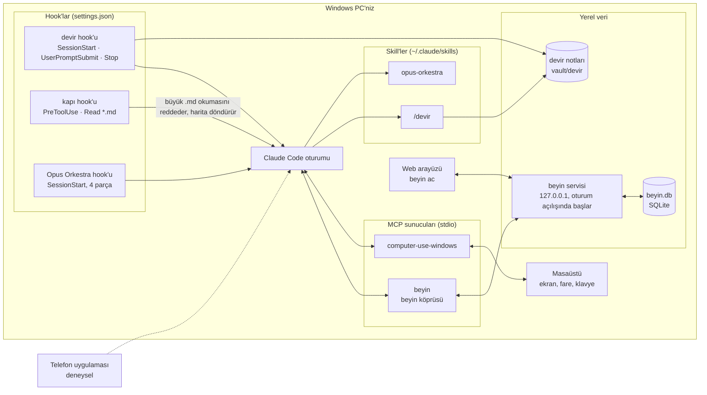
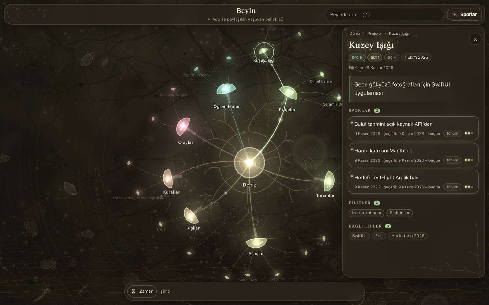

<div align="center">

<picture>
  <source media="(prefers-color-scheme: dark)" srcset="docs/assets/banner-dark.svg">
  
</picture>

**Claude Code için bellek, orkestrasyon ve eller.**

[](LICENSE)
[](#-hızlı-başlangıç)
[](packages/bellek/pyproject.toml)
[-5FA04E.svg)](apps/phone/package.json)
[](https://docs.claude.com/en/docs/claude-code/overview)
[](CHANGELOG.md)

[English](README.md) · Türkçe

</div>

---

## 💡 Neden

Claude Code güçlü bir eş programcıdır, ama kutudan çıktığı haliyle oturum bitince her şeyi unutur,
tüm işi sürekli büyüyen tek bir bağlamın içinde yapar ve Windows CLI'da ekranınızı göremez, kullanamaz.
eren-kit bu üç boşluğu dolduran kişisel bir araç takımıdır: oturumlar arasında kalıcı yerel bir
**bellek** (ve oturumlar arası devir notları), ana modelin işi dar kapsamlı alt agent'lara
dağıtmasını sağlayan bir **orkestrasyon** kuralı ve Windows için bir computer-use MCP sunucusu
biçiminde **eller**. Her şey kendi makinenizde çalışır ve kurulum tek bir PowerShell betiğiyle yapılır.

> [!NOTE]
> eren-kit **alfa** aşamasında bir yazılımdır; tek bir kişinin Windows kurulumu için yazıldı ve
> orada test edildi. Belgelerin ve Opus Orkestra kurallarının bir kısmı hâlâ Türkçedir. Pürüzler
> olabilir; önce `-DryRun` ile kurulum betiğinin neler yapacağını okuyun.

## 🧩 İçinde neler var

<p align="center">
  
</p>

| Bileşen | Ne yapar | Tür | Durum |
| --- | --- | --- | --- |
| [**Bellek & Beyin**](#bellek--beyin-beyin) (`packages/bellek`) | Sizin ve işleriniz hakkında kalıcı, hiyerarşik bir bilgi ağacı; Claude'a `beyin` MCP sunucusu olarak sunulur, yerel bir web arayüzü vardır | MCP · CLI · Web arayüzü | Çalışıyor (alfa) |
| [**Devir**](#devir-devir) (`packages/bellek`) | Bir sonraki oturumun kaldığı yerden devam edebilmesi için devir notları yazar; pahalı uzun bağlamlar için uyarır | Hook · Skill | Çalışıyor (alfa) |
| [**Önce harita belge kapısı**](#önce-harita-belge-kapısı-kapi) (`packages/bellek`) | Büyük Markdown belgelerini ilk okumada reddedip başlık haritasını döndürür; ajan yalnız gereken bölümü okur | Hook | Çalışıyor (alfa) |
| [**Opus Orkestra**](#opus-orkestra) (`packages/opus-orkestra`) | Çalışma kuralı: ana model kodu kendisi yazmaz, işi çok sayıda dar kapsamlı alt agent'a böler ve sonucu doğrular | Skill · Hook | Çalışıyor; kurallar Türkçe |
| [**computer-use-windows**](#computer-use-windows) (`packages/computer-use-windows`) | Windows'ta terminal agent'ları için ekran, UI Automation, fare ve klavye; koruma önlemleriyle | MCP | Çalışıyor (0.1.0) |
| [**Telefon uygulaması (deneysel)**](#telefon-uygulaması-deneysel) (`apps/phone`) | Telefonunuzdan PC'nizdeki ana Claude oturumuyla konuşun | Uygulama | **Deneysel**, kullanıma hazır değil |

## 🏗️ Mimari



Claude Code, stdio üzerinden iki yerel MCP sunucusuyla konuşur. Hook'lar oturum başında bağlam ekler,
tur bittiğinde devir notlarını yazar. Beyin veritabanının tek bir yazıcısı vardır: `127.0.0.1`
üzerindeki küçük bir servis; MCP köprüsü de web arayüzü de onun üzerinden geçer. Telefon bağlantısı
(kesikli çizgi) deneyseldir.

## 🚀 Hızlı başlangıç

### Ön koşullar

| Gereksinim | Ne için gerekli | Notlar |
| --- | --- | --- |
| Windows 10 veya 11 | her şey | macOS'ta `install.sh` kullanın, bkz. [macOS ve iOS](#-macos-ve-ios). Linux henüz desteklenmiyor |
| PowerShell | kurulum betiği | PowerShell 7 önerilir; Windows PowerShell 5.1 de çalışır |
| Python 3.12+ | Bellek & Beyin, Devir | computer-use-windows ve kurulum betiği için 3.11+ yeterli |
| `PATH` üzerinde `python`, 3.11+ | Devir, kapı (`kapi`) ve Opus Orkestra hook'ları | Hook'lar doğrudan `python` komutunu çağırır ve kurulum betiği sürümünü denetler. Python'u kurarken **"Add python.exe to PATH"** kutusunu işaretleyin |
| [Claude Code CLI](https://docs.claude.com/en/docs/claude-code/setup) (`claude`) | MCP kaydı | Yoksa kurulum betiği MCP adımlarını atlar ve elle yapılacak komutu yazdırır |
| Node 24+ ve npm | yalnızca Telefon uygulaması | Varsayılan kurulum için gerekmez |

### Kurulum

```powershell
git clone https://github.com/SelmanBoray/eren-kit.git
cd eren-kit

.\install.ps1 -DryRun                    # isteğe bağlı: neyin değişeceğini listeler, hiçbir şeyi değiştirmez
.\install.ps1 -AssistantName "Ada"       # varsayılan bileşenleri kurar
```

Çalıştırma politikası betiği engellerse:

```powershell
powershell -ExecutionPolicy Bypass -File .\install.ps1
```

Ardından:

1. **Claude Code'u yeniden başlatın**; yeni MCP sunucularını, hook'ları ve skill'leri tanısın.
2. **MCP sunucularını kontrol edin:**

   ```powershell
   claude mcp list        # "beyin" ve "computer-use-windows" listelenmeli
   ```

3. **Beynin web arayüzünü açın** (isteğe bağlı). Beyin servisi zaten arka planda çalışıyor:
   kurulum betiği onu zamanlanmış görev olarak kaydeder ve hemen başlatır.

   ```powershell
   packages\bellek\.venv\Scripts\beyin ac
   ```

4. **İsteğe bağlı: not klasörünüzü ayarlayın.** Kurulum betiği, yoksa `bellek.example.toml`
   dosyasını `packages\bellek\bellek.toml` olarak kopyalar. Devir notlarının
   `packages\bellek\vault` dışında bir yerde durmasını istiyorsanız oradaki `vault` değerini düzenleyin.

### Bileşenleri seçin

Varsayılan küme `beyin, devir, kapi, orkestra, computer-use` bileşenleridir. Telefon uygulaması yalnızca
siz isterseniz kurulur.

```powershell
.\install.ps1 -Components beyin,devir          # yalnızca bellek + devir
.\install.ps1 -Components kapi                 # yalnızca önce harita belge kapısı
.\install.ps1 -Components orkestra             # yalnızca orkestrasyon kuralı
.\install.ps1 -Components computer-use         # yalnızca Windows computer-use sunucusu
.\install.ps1 -Components phone                # deneysel telefon uygulaması bağımlılıkları (npm ci)
```

Kurulum betiğini yeniden çalıştırmak güvenlidir: değişeni günceller, geri kalanına dokunmaz.

### Kurulum doktoru

`python scripts/installer/doktor.py` (ya da `.\install.ps1 -Doctor`, `./install.sh --doctor`) kurulu
bileşenlerin Claude Code'a doğru bağlandığını salt okunur denetler: hook kayıtları (yineleme, eski
konum, eksik olay, betik yolu), kurulu skill kopyalarının depodakiyle aynı olup olmadığı, MCP
kayıtları, beyin servisi ve görevi. `--json` makine çıktısı verir, `--no-network` canlı sistem
sorgularını ve dış süreçleri atlar. Çıkış kodu: 0 sorun yok, 1 uyarı, 2 hata. Kurulmamış bileşen hata
sayılmaz. Kurulum, gerçek bir kurulumun sonunda doktoru bir kez çalıştırır.

## 🍎 macOS ve iOS

<p align="center">
  
</p>

macOS'ta `install.sh`, Windows'taki `install.ps1` ile aynı işi aynı kurallarla yapar: `settings.json`
dosyasını birleştirir, değiştirdiği her şeyi yedekler, yeniden çalıştırmak güvenlidir ve yalnızca
kendi kurduğunu kaldırır.

```bash
git clone https://github.com/SelmanBoray/eren-kit.git && cd eren-kit
./install.sh --dry-run                    # neyin değişeceğini listele, hiçbir şeyi değiştirme
./install.sh --assistant-name "Ada"       # beyin, devir, kapi, orkestra kur
./install.sh --uninstall                  # geri kaldır (venv'ler ve verin kalır)
```

Python 3.12+ (`brew install python@3.13`) ve Claude Code CLI gerekir. Seçenekler Windows betiğiyle
aynıdır: `--components`, `--claude-home`, `--skip-mcp`, `--no-service`, `--keep-existing`, `--doctor`,
`--json` (`--replace-existing` uyumluluk için hâlâ kabul edilir ama gerekmez); ayrıca
`--tailscale-host` (aşağıda).

| | Windows | macOS |
| --- | --- | --- |
| Beyin servisi | Oturum açılışında Görev Zamanlayıcı görevi | LaunchAgent `com.eren-kit.beyin-servis` (`~/Library/LaunchAgents`); çökerse yeniden başlar, günlük `~/Library/Logs/eren-kit` altında |
| Yerel veri | `%LOCALAPPDATA%\Bellek` | `~/Library/Application Support/Bellek` |
| Hook yorumlayıcısı | `PATH`'teki `python` | 3.11+ bir Python'un mutlak yolu (macOS'ta `python` komutu genelde yoktur) |
| Asistan adı | kullanıcı ortam değişkeni | `settings.json` içindeki `env` alanı ve servis plist'i |
| Computer use | `computer-use-windows` MCP | Claude Code'un [yerleşik computer use'u](https://code.claude.com/docs/en/computer-use): oturumda `/mcp` → `computer-use` → **Enable** (Pro/Max, etkileşimli oturum) |

<p align="center"></p>
<p align="center"><sub>macOS'ta beyin web arayüzü (örnek veri).</sub></p>

**iPhone ve iPad.** Beynin web arayüzü mobil Safari'de çalışır ve ana ekrana uygulama olarak
eklenebilir (web manifesti ve ikonu vardır). Yalnızca kendi cihazlarına, tailnet üzerinden aç:

```bash
tailscale serve --bg --http 80 http://127.0.0.1:47321
./install.sh --components beyin --tailscale-host "<mac>.<tailnet>.ts.net"
packages/bellek/.venv/bin/beyin ac --yazdir --taban "http://<mac>.<tailnet>.ts.net"
```

Yazdırılan adresi telefonda aç, ardından Paylaş → **Ana Ekrana Ekle**. Ana ekran uygulamasının ayrı
depolaması vardır; ilk açılışta aynı adresi (ya da yalnızca anahtarı) giriş ekranındaki alana
yapıştır, yalnızca o uygulama için hatırlanır. Normal tarayıcı sekmesinde anahtar yine yalnızca
oturum boyunca tutulur. İnternete hiçbir şey açılmaz: funnel yok, servis yine yalnızca `127.0.0.1`
üzerinde dinler.


## 🛠️ `install.ps1` başvurusu

```text
.\install.ps1 [-Components <list>] [-AssistantName <name>] [-ClaudeHome <folder>]
              [-DryRun] [-Uninstall] [-SkipMcp] [-NoService] [-KeepExisting] [-Help]
.\install.ps1 -Doctor [-Json] [-ClaudeHome <folder>]
```

| Parametre | Açıklama |
| --- | --- |
| `-Components` | Virgülle ayrılmış bileşen listesi, ör. `-Components beyin,devir`. Geçerli değerler: `beyin`, `devir`, `kapi`, `orkestra`, `computer-use`, `phone`. Varsayılan: `beyin, devir, kapi, orkestra, computer-use` |
| `-AssistantName` | Asistan adı; `EREN_KIT_ASSISTANT_NAME` kullanıcı ortam değişkenine yazılır. Verilmezse mevcut değer korunur, o da yoksa `"Claude"` kullanılır |
| `-ClaudeHome` | Claude Code ayar klasörü. Varsayılan: `CLAUDE_CONFIG_DIR` ortam değişkeni tanımlıysa o, değilse `%USERPROFILE%\.claude` |
| `-DryRun` | Hiçbir şeyi değiştirmez; yapılacakları listeler |
| `-Uninstall` | Seçilen bileşenlerin MCP kayıtlarını, hook'larını, kopyalanan skill'lerini, beyin servisi görevini ve (`phone` için) `eren-kit-telefon` zamanlanmış görevini kaldırır. Venv'leri ve kullanıcı verisini **silmez** |
| `-SkipMcp` | `claude mcp add/remove` adımlarını atlar |
| `-NoService` | Zamanlanmış görevlere dokunmaz: beyin servisinin görevini kurmaz (veya kaldırmaz), kaldırmada telefon bileşeninin görevini de silmez; servisleri kendiniz yönetirsiniz |
| `-KeepExisting` | `settings.json` içinde, depo dışındaki aynı hook betiklerinin eski kopyalarına ait girdileri (ör. başka bir klasördeki `bellek\devir\hook.py` ya da `bellek\kapi\hook.py`, `~\.claude\hooks\opus-orkestra-sessionstart.py`) bilerek korur. Verilmezse bunlar varsayılanda yedek alınarak yenisiyle değiştirilir; verilirse eskiler kalır ve o hook'lar iki kez çalışır |
| `-ReplaceExisting` | Uyumluluk anahtarı: eski kopyaların değiştirilmesi artık varsayılandır; bu anahtar hâlâ kabul edilir ama gerekmez. `-KeepExisting` ile birlikte verilemez |
| `-Doctor` | Kurulum yapmaz; yalnızca [kurulum doktorunu](#kurulum-doktoru) çalıştırır ve onun çıkış koduyla çıkar |
| `-Json` | `-Doctor` ile birlikte kullanılır: doktor çıktısını JSON olarak verir |
| `-Help` | Yerleşik yardımı gösterir (Türkçe) |

| Bileşen | Kurulum betiği ne yapar |
| --- | --- |
| `beyin` | `packages\bellek\.venv` oluşturur ve `pip install -e` çalıştırır; yoksa `bellek.example.toml` dosyasını `bellek.toml` olarak kopyalar; `bellek.beyin` modülünün içe aktarılabildiğini denetler; `beyin` MCP sunucusunu kaydeder (kullanıcı kapsamı); beyin servisi görevini kaydedip başlatır (aşağıya bakın) |
| `devir` | Aynı venv'i kullanır; `PATH` üzerindeki `python` komutunun 3.11+ olduğunu denetler; devir hook'unu `SessionStart`, `UserPromptSubmit` ve `Stop` olaylarına ekler; skill'i `<ClaudeHome>\skills\devir` klasörüne kopyalar |
| `kapi` | `PATH` üzerindeki `python` komutunun 3.11+ olduğunu denetler; kapı hook'unu `PreToolUse` olayına ekler (`Read` için `.md`/`.markdown` filtresiyle). Venv ya da skill yoktur |
| `orkestra` | `PATH` üzerindeki `python` komutunun 3.11+ olduğunu denetler; `SKILL.md` dosyasını `<ClaudeHome>\skills\opus-orkestra` klasörüne kopyalar; dört `SessionStart` hook komutu ekler |
| `computer-use` | `packages\computer-use-windows\.venv` oluşturur ve `pip install -e` çalıştırır; `computer-use-windows` MCP sunucusunu kaydeder (kullanıcı kapsamı) |
| `phone` | Node 24+ ve npm olup olmadığına bakar; `apps\phone` içinde `npm ci` çalıştırır. Hiçbir şey kaydedilmez; elle başlatılır |

Mevcut kurulumunuza nasıl davrandığı:

- **`settings.json` birleştirilir, üzerine yazılmaz.** Diğer ayarlarınız ve hook'larınız korunur.
  eren-kit'in hook'ları depo içindeki betik yollarından tanınır; bu yüzden yeniden çalıştırmak onları
  asla ikiye katlamaz, depoyu taşırsanız eski girdiler güncellenir. Hiçbir şey değişmiyorsa dosyaya
  dokunulmaz.
- **Önce yedek.** `settings.json` değiştirilmeden ya da bir skill klasörü değiştirilmeden önce
  orijinal `<ClaudeHome>\backups\eren-kit\<timestamp>\` altına kopyalanır.
- **MCP kayıtları** `claude` CLI'ının kendi kullanıcı yapılandırmasına gider (`-ClaudeHome`'dan
  bağımsızdır). Aynı olan bir kayda dokunulmaz. Adı aynı ama komutu farklı olan bir kayıt önce
  yedeklenir, sonra değiştirilir; yenisi eklenemezse eskisi geri yüklenir. Bu kayıt deponun dışını
  gösteriyorsa kurulum betiği bunu söyler, `-DryRun` sırasında da.
- **Beyin servisi görevi.** `beyin` bileşeni, `eren-kit-beyin-servis` adlı kullanıcı düzeyinde bir
  Görev Zamanlayıcı görevi kaydeder (yönetici hakkı gerekmez). Görev,
  `packages\bellek\.venv\Scripts\pythonw.exe -m bellek.beyin servis` komutunu her oturum açılışında
  sessizce çalıştırır ve kurulumdan hemen sonra başlatılır. Yeniden kurulum onu günceller ve yeniden
  başlatır; `-Uninstall -Components beyin` durdurup kaldırır; `-NoService` bu adımı atlar. Aynı servisi
  başka bir görev zaten çalıştırıyorsa kurulum betiği sizi uyarır, çünkü ikisi aynı bağlantı noktasını
  kullanır.
- **Kopyalanan skill'lere** küçük bir `.eren-kit` işaret dosyası konur. `-Uninstall` yalnızca bu
  işareti taşıyan ya da depodaki kopyayla eşleşen skill klasörlerini kaldırır, önce onları yedekler;
  geri kalan her şeye dokunulmaz. Yedek alınamazsa hiçbir şey silinmez.

### Elle kurulumdan geçiş

Bu parçalardan herhangi birini daha önce elle kurduysanız (örneğin başka bir klasördeki devir hook'unu
ya da `~\.claude\hooks` altındaki Opus Orkestra hook'unu), geçiş kendiliğinden olur: kurulum betiği
aynı bileşenin eski konumdaki hook kaydını yedek alarak yenisiyle değiştirir. Ne değişeceğini önceden
görmek için `-DryRun` kullanın; eskileri bilerek korumak isterseniz `-KeepExisting` verin (o zaman o
hook'lar iki kez çalışır):

```powershell
.\install.ps1 -DryRun                       # hangi eski kayıtların değişeceğini göster
.\install.ps1                               # eski kayıtları değiştir (settings.json önce yedeklenir)
.\install.ps1 -KeepExisting                 # eski kayıtları bilerek koru
```

Bu işlem yalnızca `settings.json` içindeki hook girdilerine dokunur; eski betik dosyalarını silmez.
`-ReplaceExisting` hâlâ kabul edilir ama artık gerekmez. Mevcut bir `beyin` ya da
`computer-use-windows` MCP kaydı da yukarıda anlatıldığı gibi (yedek alınarak) değiştirilir;
`-DryRun` bunu önceden gösterir.

### Kaldırma

```powershell
.\install.ps1 -Uninstall                         # default components
.\install.ps1 -Uninstall -Components orkestra    # just one
```

Bu işlem hook'ları, kopyalanan skill'leri, beyin servisi görevini ve bu depoyu gösteren MCP
kayıtlarını kaldırır; telefon bileşenini kaldırmak `eren-kit-telefon` zamanlanmış görevini de siler (başka yeri gösteren bir `beyin` ya da `computer-use-windows` kaydı uyarıyla
birlikte yerinde bırakılır). Venv'leri, `bellek.toml` dosyasını, beyin veritabanınızı, notlarınızı ve
`EREN_KIT_ASSISTANT_NAME` değişkenini korur; kalmasını istemiyorsanız bunları elle silin.

## 📦 Bileşenler

### Bellek & Beyin (`beyin`)

Sizin hakkınızda hiyerarşik bir "beyin haritası": başlığı, özeti ve ayrıntısı olan düğümler, yalnızca
eklenebilen olgular, net bir yeri olmayan öneriler için bir gelen kutusu ve bir değişiklik geçmişi;
hepsi tek bir SQLite dosyasında.

- **Altı MCP aracı:** `beyin_ara` (arama), `beyin_gez` (bir düğümü ve çocuklarını gezme),
  `beyin_oku` (bir düğümü okuma), `beyin_yaz` (olgu ekleme), `beyin_duzelt` (özeti/ayrıntıyı
  düzenleme ya da bir olguyu emekli etme), `beyin_gelen` (gelen kutusu öğelerini listeleme veya karara bağlama).
- **Tek yazıcı.** `127.0.0.1` üzerindeki (varsayılan bağlantı noktası `47321`) yerel bir servis,
  veritabanına yazan tek süreçtir. Kurulum betiği onu her oturum açılışında arka planda çalıştırır
  (zamanlanmış görev `eren-kit-beyin-servis`). Çalışmıyorsa okumalar salt okunur bir bağlantıyla yine
  çalışır, `beyin_yaz` yazmaları ise servis başlayana kadar kuyruğa alınır.
- **Web arayüzü.** `beyin ac`, beyni zamanla büyüyen parlak bir miselyum ağı olarak çizen, ağırlıklı
  olarak salt okunur bir görünümü tarayıcınızda açar. Yalnızca gelen kutusu kararlarını yazabilir.
- **Koruma önlemleri.** Sır gibi görünen metinler `beyin_yaz` tarafından reddedilir; düğümler özel
  olarak işaretlenebilir.
- **Araç adları ve CLI Türkçedir** (`ara` = arama, `gez` = gezme, `oku` = okuma,
  `yaz` = yazma, `duzelt` = düzeltme, `gelen` = gelen kutusu).

```powershell
# from the repository root
packages\bellek\.venv\Scripts\beyin ac         # web arayüzünü açar (servis çalışıyor olmalı)
packages\bellek\.venv\Scripts\beyin ara "proje teslim tarihleri"
packages\bellek\.venv\Scripts\bellek doktor    # kurulumun sağlık denetimi (beyin veritabanını da denetler)
```

Beyin yedekleri ve yeniden içe alım (`python -m bellek.beyin ...`):

```powershell
python -m bellek.beyin yedekle [--dizin D] [--sakla N]   # SQLite çevrimiçi yedeği alır
python -m bellek.beyin yedekler                          # yedekleri listeler
python -m bellek.beyin geri-yukle <yedek> [--evet]       # yedekten geri yükler
python -m bellek.beyin ice-al --uzerine-yaz              # yeniden içe alım; tohum kazanır
```

- **Yedek:** SQLite çevrimiçi yedeği kullanılır; en yeni 14 yedek saklanır (`--sakla` ile değişir).
  Yerel yedekler şifresizdir.
- **Geri yükleme** yalnızca servis kapalıyken çalışır; eski veritabanı silinmez, kenara alınır.
- **`ice-al`:** yeniden içe alım, tohumdan sonra kullanıcının düzelttiği düğümleri korur; `--uzerine-yaz`
  ile bu korumadan vazgeçilir ve tohum kazanır.
- **`bellek doktor`** artık beyin veritabanını da denetler.

`-NoService` ile ya da elle kurduysanız servisi kendiniz başlatın ve o terminali açık bırakın
(veya kendi otomatik başlatmanızı kurun):

```powershell
packages\bellek\.venv\Scripts\beyin servis
```

Claude Code'da örnek istemler:

- "Şu anki projelerim hakkında neler biliyorsun?"
- "Küçük ve sık commit'leri tercih ettiğimi hatırla."
- "O teslim tarihi cumaya kaydı, beyni güncelle."

Ayrıntılar: [packages/bellek/README.md](packages/bellek/README.md) (Türkçe, İngilizce özetle)
ve tasarım sözleşmesi [packages/bellek/DESIGN.md](packages/bellek/DESIGN.md).

### Devir (`devir`)

Uzun oturumlar pahalıdır. Devir, konunun ipini kaybetmeden yeni, kısa bir oturuma geçmenizi sağlar.

- **`Stop` hook'u:** oturum başına kısa bir otomatik not yazar.
- **`SessionStart` hook'u:** oturum kimliğini ve son notların bir dizinini yeni oturumun bağlamına ekler.
- **`UserPromptSubmit` hook'u:** uzun bir aradan sonra önbelleği yeniden yazma maliyeti ve çok büyük
  bağlamlar konusunda uyarır (bağlama metin eklemez).
- **`/devir` skill'i:** istek üzerine zengin bir devir notu yazar ve bir sonraki oturumun onu okumasına yardım eder.
- **Hata durumunda sessiz (fail-open):** herhangi bir hatada hook hiçbir şey yazdırmaz ve oturumu asla engellemez.
- **Temizlik:** 28 günden eski otomatik notlar `SessionStart` sırasında silinir.
- **`/devir` boşluk engeline takılmaz:** `/devir` ile başlayan istem hook'un boşluk engeline takılmadan geçer.

Notlar `BELLEK_DEVIR_DIR` altında tutulur; varsayılan olarak `vault` klasörünüzün içindeki `devir`
klasörüdür (otomatik notlar `devir\oto\` içinde).

Örnek: oturumu kapatmadan önce `/devir` yazın, yeni oturumda da *"son devir notundan devam et"* deyin.

Ayrıntılar: [packages/bellek/README.md](packages/bellek/README.md) ve skill dosyası
[packages/bellek/skills/devir/SKILL.md](packages/bellek/skills/devir/SKILL.md).

### Önce harita belge kapısı (`kapi`)

Büyük bir Markdown belgesini baştan sona okumak bağlamı boşuna doldurur. Kapı, Bellek paketindeki bir
Claude Code `PreToolUse` hook'udur (`packages/bellek/src/bellek/kapi/hook.py`): bir ajan (ana oturum ya
da alt agent) ≥16 KB'lık bir Markdown dosyasına ilk kez dokunduğunda okumayı reddeder ve gerekçe olarak
başlık haritasını (her başlığın satır aralığı ve boyutu) döndürür. Ajan sonra yalnız gereken bölümü
`offset`/`limit` ile okur.

- **Neden:** ölçümde alt agent'lar büyük proje belgelerini tekrar tekrar 275-280 satırlık parçalar
  halinde okuyordu.
- **Geçenler:** ≤80 satırlık hedefli okumalar geçer; ikinci deneme her zaman geçer, yani kapı asla
  kilitlemez.
- **Ucuz:** hook `if` filtresiyle (`Read(//**/*.md)`, `Read(//**/*.markdown)`) kayıtlıdır; diğer
  okumalarda süreç başlatılmaz.
- **Hata durumunda sessiz (fail-open):** herhangi bir hatada okuma olduğu gibi geçer.
- **Sıkıştırmadan sonra:** bağlam sıkıştırmasından (compact) sonra harita yeniden gösterilir; bunun için
  kurulum kapıyı `SessionStart` olayına `compact` eşleştiricisiyle de kaydeder.
- **Kapatma:** `BELLEK_KAPI=kapali` ortam değişkeni ya da `.\install.ps1 -Uninstall -Components kapi`.
- **Ölçüm günlüğü:** `%LOCALAPPDATA%\Bellek\kapi\kapi.jsonl`.

### Opus Orkestra

Kodlama oturumları için bir çalışma kuralı: ana model kodu kendisi yazmaz. İşi çok sayıda dar
kapsamlı alt agent'a böler (basit, sınırları net işler için Sonnet; karmaşık işler için Opus), her
birinin sınırlarını belirler ve sonucu doğrular.

- **Neden:** ana modelin bağlamı plan ve sizin niyetiniz üzerinde kalır; bağımsız işler paralel
  yürür; taze bağlamlı bir gözden geçirici, yazarın varsayımlarına çıpalanmaz.
- **Her zaman açık:** bir `SessionStart` hook'u kuralları her oturumun başında enjekte eder. Claude
  Code hook bağlamını 10.000 karakterle sınırladığı için metin `## ` başlıklarından bölünür ve dört
  hook komutuyla (`--parca 1` ile `--parca 4`) iletilir.
- **Kapatma:** modelden bir oturum için kapatmasını isteyin ya da
  `.\install.ps1 -Uninstall -Components orkestra` ile kaldırın.
- **Dil:** kural metni şu an Türkçedir. İngilizce sürüm [yol haritasında](#-yol-haritası).

Ayrıntılar: [packages/opus-orkestra/README.md](packages/opus-orkestra/README.md) ve kurallar
[packages/opus-orkestra/skill/SKILL.md](packages/opus-orkestra/skill/SKILL.md) dosyasında.

### computer-use-windows

Claude Code'un yerleşik computer use özelliği Windows'taki CLI'da yoktur. Bu MCP sunucusu onu
terminalinizdeki agent'a getirir; iki kural üzerine kuruludur: **önce terminal** ve **token tasarrufu**.

- **12 araç:** `screenshot`, `zoom`, `elements`, `windows`, `focus`, `click`, `type_text`, `key`,
  `scroll`, `drag`, `move`, `wait`.
- **Piksellerden önce metin.** `elements`, arayüzü Windows UI Automation üzerinden okur; ekran
  görüntüleri varsayılan olarak yaklaşık 1,2 bin token'a küçültülür; eylem araçları asla görüntü döndürmez.
- **Koruma önlemleri.** Parola alanlarına ve terminallere yazmayı reddeder, uygulama engelleme
  listesini (`--block`) destekler ve bir acil durdurma düzeneği vardır: **durdurmak için fareyi bir ekran köşesine götürün.**
- **Yalnızca yerel:** ağ erişimi yok, telemetri yok.
- **Güvenlik özeti:** yazma, her Tab ya da Enter'dan sonra parola alanı / terminal / engelli uygulama
  kurallarını yeniden denetler ve ön pencere değişince durur; terminale sağ ve orta tık reddedilir;
  listelenen pencere taşındıysa ya da kapandıysa `click(element=…)` reddedilir.

Örnek istemler:

- "Ayarlar'ı aç ve Gece ışığı'nı etkinleştir."
- "Uygulamamı `bin\Debug` içinden başlat, kayıt formunu doldur ve Kaydet düğmesinin etkinleşip etkinleşmediğini söyle."

Ayrıntılar, seçenekler ve token maliyet tabloları:
[packages/computer-use-windows/README.tr.md](packages/computer-use-windows/README.tr.md).

### Telefon uygulaması (deneysel)

> [!WARNING]
> Bu çalışma henüz devam ediyor ve **kullanıma hazır değil**. Arayüzler, protokol ve güvenlik modeli
> değişebilir. Test sunucusunda kimlik doğrulama yoktur: onu asla güvenmediğiniz bir ağa açmayın.

Telefonunuzdan PC'nizdeki ana Claude Code oturumuyla konuşun. Ana oturum işi kendisi yapmaz; her
görev için yeni bir Claude Code oturumu açar, onaylamanız için bir plan gösterir ve sonucu geri
bildirir. Her sohbetin kendi ana oturumu vardır; bir görev oturumu kısıtlı bir araç kümesiyle (ekran
okuma, dokunma, yazma) Android cihazı da yönetebilir. Dizin ortak protokolü, PC servisini, Expo /
React Native Android uygulamasını ve Kotlin `eren-device` modülünü, kurulum betiklerini
(`kurulum/kur.ts`), belgeleri ve bağımsız bir ölçüm deneyini içerir. Hâlâ deneyseldir.

Yapılandırma ortam değişkenleriyledir (tam liste
[telefon README'sinde](apps/phone/README.md)):

| Değişken | Varsayılan | Anlamı |
| --- | --- | --- |
| `EREN_KIT_ASSISTANT_NAME` | `Claude` | PC servisinde ve derleme anında uygulamada görünen asistan adı. Verilmezse uygulamanın başlatıcı adı `eren-kit` olur |
| `EREN_KIT_DATA_DIR` | `%LOCALAPPDATA%\eren-kit` | Veri kökü; mutlak yol olmalı. Servis, bekçi ve kurulum aynı kuralı uygular |
| `EREN_KIT_PHONE_TASK_NAME` | `eren-kit-telefon` | Kurulumun kaydettiği zamanlanmış görevin adı |

Eşleşmiş cihazlar PC'de listelenip eşleşmeleri kaldırılabilir (`apps/phone` dizininde
`node --disable-warning=ExperimentalWarning server/src/eslestir.ts --liste` ve
`... eslestir.ts --kaldir <kimlik>`; ayrıntı [GUVENLIK.md](apps/phone/docs/GUVENLIK.md)'de). Sunucu her
bağlantıya ping atar ve yanıt vermeyen (ölü) bağlantıyı en geç 60 saniyede kapatır.

Ayrıntılar (Türkçe, İngilizce özetle): [apps/phone/README.md](apps/phone/README.md). Servis işletimi
(kurulum, güncelleme, zamanlanmış görev): [apps/phone/docs/SERVIS.md](apps/phone/docs/SERVIS.md).

### Elle kurulum

<details>
<summary><code>install.ps1</code> yerine bileşenleri elle kurun</summary>

Aşağıdaki komutlar deponun kök dizininde olduğunuzu varsayar.

**Bellek & Beyin**

```powershell
cd packages\bellek
py -3.12 -m venv .venv
.venv\Scripts\python -m pip install -e .
Copy-Item bellek.example.toml bellek.toml        # sonra yolları düzenleyin
.venv\Scripts\bellek doktor
claude mcp add beyin -s user -- "$PWD\.venv\Scripts\python.exe" -m bellek.beyin mcp
.venv\Scripts\beyin servis                       # beyin servisi; bu terminali açık bırakın
```

Kurulum betiği olmadan zamanlanmış görev de olmaz; yazmaların uygulanmasını ve web arayüzünün
açılmasını istediğiniz her an `beyin servis` komutunu kendiniz (ya da kendi Görev Zamanlayıcı
girdinizle) başlatın.

**Devir**

`packages\bellek\skills\devir` klasörünü `~\.claude\skills\devir` altına kopyalayın, ardından şu
komutu `~\.claude\settings.json` içindeki `SessionStart`, `UserPromptSubmit` ve `Stop` olaylarına
ekleyin (`<repo>` yerine deponun yolunu yazın; `|| true`, hata veren bir hook'un oturumu
engellemesini önler):

```text
python -I -S "<repo>/packages/bellek/src/bellek/devir/hook.py" || true
```

**Önce harita belge kapısı**

Aynı komutu `~\.claude\settings.json` içinde iki kayıt olarak ekleyin: `PreToolUse` olayına `Read`
eşleştiricisiyle (`if` filtreleri `Read(//**/*.md)` ve `Read(//**/*.markdown)`, bir kayıt her biri için)
ve `SessionStart` olayına `compact` eşleştiricisiyle (`if` filtresiz):

```text
python -I -S "<repo>/packages/bellek/src/bellek/kapi/hook.py" || true
```

**Opus Orkestra**

`packages\opus-orkestra\skill\SKILL.md` dosyasını `~\.claude\skills\opus-orkestra\SKILL.md` olarak
kopyalayın ve
[packages/opus-orkestra/README.md](packages/opus-orkestra/README.md#install) içinde gösterilen dört
`SessionStart` komutunu ekleyin (kurulum betiği her komutun sonuna `|| true` ekler; siz de ekleyin).

**computer-use-windows**

```powershell
cd packages\computer-use-windows
python -m venv .venv
.venv\Scripts\python -m pip install -e .
claude mcp add computer-use-windows -s user -- "$PWD\.venv\Scripts\computer-use-windows.exe"
```

Klonlamadan, `uvx` ile de çalıştırılabilir; bkz.
[packages/computer-use-windows/README.tr.md](packages/computer-use-windows/README.tr.md#alternatif-klonlamadan-uvx).

</details>

## ⚙️ Yapılandırma

### Ortam değişkenleri

| Değişken | Kullanan | Varsayılan | Anlamı |
| --- | --- | --- | --- |
| `CLAUDE_CONFIG_DIR` | kurulum betiği | `%USERPROFILE%\.claude` | Claude Code'un ayar klasörü; kurulum betiği `-ClaudeHome` için varsayılan olarak bunu kullanır |
| `EREN_KIT_ASSISTANT_NAME` | beyin web arayüzü, telefon uygulaması | `Claude` | Asistanın görünen adı. `-AssistantName` ile ayarlanır. Claude Code içinde Claude'u yeniden adlandırmaz |
| `EREN_KIT_DATA_DIR` | telefon uygulaması | `%LOCALAPPDATA%\eren-kit` | Telefon servisinin veri kökü (mutlak yol) |
| `EREN_KIT_PHONE_TASK_NAME` | telefon uygulaması | `eren-kit-telefon` | Telefon kurulumunun kaydettiği zamanlanmış görevin adı |
| `BELLEK_CONFIG` | Bellek & Beyin, Devir | `packages\bellek\bellek.toml` | Yapılandırma dosyasının yolu |
| `BELLEK_BEYIN_DB` | Bellek & Beyin | `%LOCALAPPDATA%\Bellek\beyin.db` (macOS: `~/Library/Application Support/Bellek/beyin.db`) | Beyin veritabanı |
| `BELLEK_BEYIN_PORT` | Bellek & Beyin | `47321` | Yerel beyin servisinin bağlantı noktası |
| `BELLEK_BEYIN_IZINLI_HOST` | Bellek & Beyin | boş | Servisin kabul ettiği ek `Host` değerleri (virgülle ayrılmış); başka bir cihazdan erişim için |
| `BELLEK_DEVIR_DIR` | Devir | `<vault>\devir` | Devir notlarının kök klasörü |
| `BELLEK_DEVIR_UYARI` | Devir | `durdur` | Uyarı kipi: `durdur` (durdur), `uyar` (uyar), `kapali` (kapalı) |
| `BELLEK_KAPI` | Önce harita belge kapısı | boş (açık) | `kapali` yapılırsa kapı hiçbir okumayı reddetmez |
| `OPUS_ORKESTRA_SKILL` | Opus Orkestra | `~\.claude\skills\opus-orkestra\SKILL.md` | Hook'un enjekte ettiği kural dosyasının yolu |
| `CUW_MAX_SIZE`, `CUW_BLOCK`, `CUW_FAILSAFE`, … | computer-use-windows | paket README'sine bakın | Görüntü boyutu, uygulama engelleme listesi, acil durdurma ve daha fazlası ([tam tablo](packages/computer-use-windows/README.tr.md#yapılandırma)) |

Beynin günlük, kuyruk ve token dosyaları için de değişkenleri vardır; bkz.
[bellek README'si](packages/bellek/README.md#ortam-değişkenleri).

### `bellek.toml`

[`packages/bellek/bellek.example.toml`](packages/bellek/bellek.example.toml) şablondur; kurulum
betiği onu `packages\bellek\bellek.toml` olarak kopyalar, bu dosya git tarafından yok sayılır. Ana anahtarlar:

```toml
[bellek]
vault = "vault"                        # your notes folder; handoff notes go to vault/devir
# state_dir = "..."                    # isteğe bağlı; varsayılan %LOCALAPPDATA%/Bellek (macOS: ~/Library/Application Support/Bellek)

[server]
host = "127.0.0.1"                     # local only
port = 47321
```

Salt okunur not kaynakları (`[[source]]`) da ekleyebilir, klasörleri proje adlarına
eşleyebilirsiniz (`[projects]`); şablon ikisini de açıklar.

## 🔒 Gizlilik ve güvenlik

- **Verileriniz yerelde kalır.** Beyin veritabanı, notlar, günlükler ve token'lar
  `%LOCALAPPDATA%\Bellek` (macOS: `~/Library/Application Support/Bellek`) ile vault klasörünüzde durur. Beyin servisi yalnızca `127.0.0.1` üzerinde dinler.
- **Depoya kişisel hiçbir şey girmez.** `bellek.toml`, `vault/`, değerlendirme verileri,
  veritabanları, `.env` dosyaları ve anahtarlar [`.gitignore`](.gitignore) içinde listelidir.
- **Model sağlayıcısına dikkat edin.** Bir aracın döndürdüğü her şey (beyin girdileri, ekran
  görüntüleri, ekran metni) Claude oturumunuzun parçası olur ve geri kalanı gibi model sağlayıcınıza gönderilir.
- **computer-use-windows gerçek farenizi ve klavyenizi kontrol eder.** Parola alanlarına ya da
  terminallere yazmaz, uygulama engelleme listesine uyar ve fareyi bir ekran köşesine götürmek her
  eylemi durdurur. O çalışırken PC'yi kullanmayın, hassas pencereleri kapatın ve parolaları kendiniz yazın.
- **Gizlilik taraması.** `python scripts/gizlilik_tara.py` izlenen dosyalarda kişisel yol, e-posta
  adresi, belirteç biçimli dizi ve büyük ikili dosya arar. İzin listesi
  `.github/gizlilik-izinli.txt`; ek yasak sözcükler `GIZLILIK_YASAK` ortam değişkeniyle verilir.
  Tarayıcı CI'da (`gizlilik` işi) çalışır; bir bulgu işi kırmızıya çevirir, bu durumda bulgu ya
  düzeltilir ya da `.github/gizlilik-izinli.txt` dosyasına dar ve gerekçeli bir satır eklenir.
- **Hook'lar hata durumunda sessizdir (fail-open).** Bozuk bir hook hiçbir şey yazdırmaz ve
  oturumunuzu asla engellemez.
- **Güvenlik açığı bildirimi:** bkz. [SECURITY.md](SECURITY.md).

## 🗂️ Depo yapısı

```text
eren-kit/
├── install.ps1                    # tek komutlu kurulum betiği (-Help ile çalıştırın)
├── scripts/
│   ├── gizlilik_tara.py           #   gizlilik tarayıcısı (kişisel yol, e-posta, belirteç)
│   └── installer/                 #   kurulum modülü, settings.json hook birleştirici, doktor.py
├── packages/
│   ├── bellek/                    # Memory & Brain + Handoff (Python 3.12+)
│   │   ├── src/bellek/            #   core, beyin (brain), devir (handoff)
│   │   ├── skills/devir/          #   /devir skill
│   │   ├── eval/                  #   retrieval evaluation set
│   │   └── bellek.example.toml    #   config template
│   ├── opus-orkestra/             # orchestration rule
│   │   ├── skill/SKILL.md         #   the rules (Turkish)
│   │   └── hooks/                 #   SessionStart hook
│   └── computer-use-windows/      # Windows computer-use MCP server (Python 3.11+)
├── apps/
│   └── phone/                     # experimental phone app (Node 24+, TypeScript; Expo app, PC service, install scripts)
├── docs/assets/                   # banner and diagrams
└── .github/workflows/ci.yml       # tests on windows-latest
```

## 🧭 Yol haritası

Kanıt ve maliyetleriyle ayrıntılı öneriler: [docs/ONERILER.md](docs/ONERILER.md).

Eksik olanların dürüst listesi, sıralama gözetmeksizin:

- [ ] **İngilizce Opus Orkestra kuralları** (şu an yalnızca Türkçe).
- [ ] **Kullanılabilir bir telefon uygulaması:** uygulama artık var, ancak kimlik doğrulama ve eşleştirme hâlâ tasarım aşamasında.
- [x] **macOS desteği** (`install.sh`, LaunchAgent, yerleşik computer use) ve iPhone/iPad'de beyin
      web arayüzü. computer-use-windows tasarım gereği yalnızca Windows içindir.
- [ ] **Linux desteği** (yollar hazır; kurulum betiği ve servis birimi henüz yok).
- [ ] **Tüm takım için `uvx` ile tek satırlık kurulum** (bugün yalnızca computer-use-windows `uvx`
      üzerinden çalışabiliyor).
- [ ] `bellek` paketi için daha fazla İngilizce belge.

## 🤝 Katkıda bulunma

Issue'lar ve pull request'ler memnuniyetle karşılanır. [CONTRIBUTING.md](CONTRIBUTING.md) her
paketin testlerinin nasıl çalıştırılacağını anlatır; CI bunları her pull request için Windows'ta çalıştırır.
Lütfen kişisel veri ya da sır asla commit'lemeyin ve asistan adını sabit yazmak yerine
`EREN_KIT_ASSISTANT_NAME` değişkeninden okuyun. Değişiklikler [CHANGELOG.md](CHANGELOG.md) dosyasında izlenir.

## 📄 Lisans

[MIT](LICENSE) © 2026 SelmanBoray

Anthropic ile bağlantılı değildir ve onun tarafından onaylanmamıştır.
