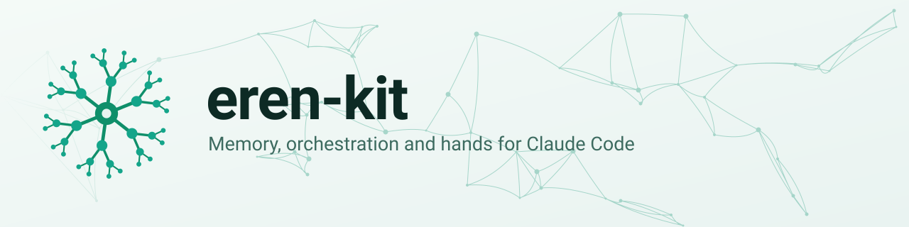
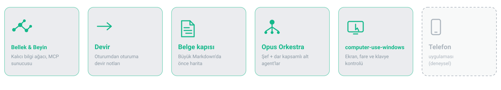
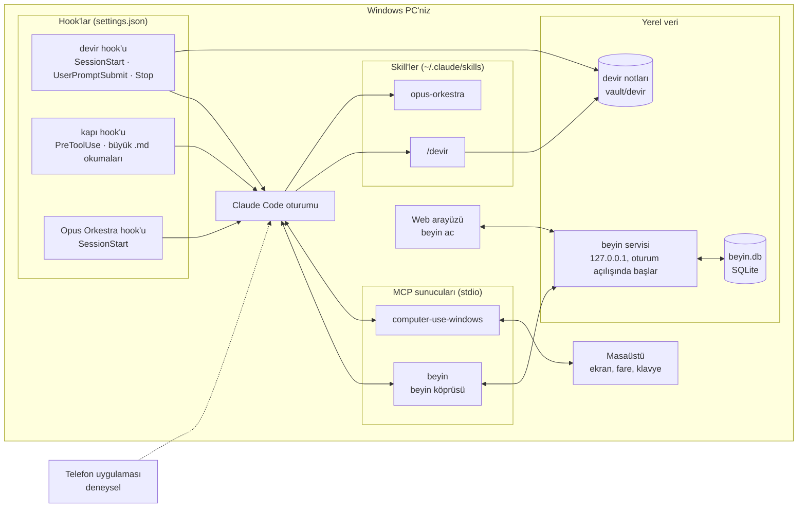
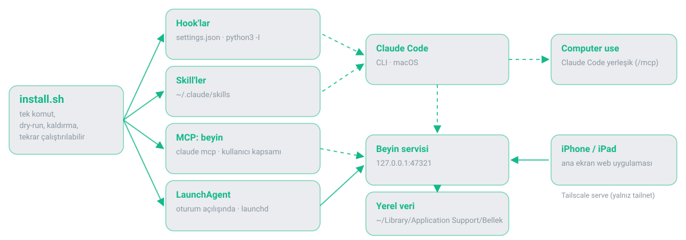

<div align="center">

<picture>
  <source media="(prefers-color-scheme: dark)" srcset="docs/assets/banner-dark.svg">
  
</picture>

**Claude Code için bellek, orkestrasyon ve eller.**

[](https://github.com/SelmanBoray/eren-kit/actions/workflows/ci.yml)
[](LICENSE)
[](#-hızlı-başlangıç)
[](packages/bellek/pyproject.toml)
[-5FA04E.svg)](apps/phone/package.json)
[](https://docs.claude.com/en/docs/claude-code/overview)
[](CHANGELOG.md)

[English](README.md) · Türkçe

</div>

---

Claude Code oturum bitince sizi unutur, her işi sürekli büyüyen tek bir bağlamın içinde yapar ve
Windows CLI'da ekranınızı göremez. **eren-kit üçünü de kendi makinenizde çözer:** Claude'un
oturumlar boyunca arayıp güncellediği yerel bir beyin, ana modeli işi dar kapsamlı alt agent'lara
dağıtan bir planlayıcıya dönüştüren bir kural ve ona Windows masaüstünde göz ve el veren bir MCP
sunucusu. Kurulum tek bir PowerShell betiğiyle yapılır; `-DryRun` her değişikliği önceden gösterir,
`-Uninstall` hepsini geri alır.

<div align="center">

**[Hızlı başlangıç](#-hızlı-başlangıç)** · [Kutuda neler var](#-kutuda-neler-var) · [Bileşenler](#-bileşenler) · [Gizlilik ve güvenlik](#-gizlilik-ve-güvenlik) · [Güvenlik politikası](SECURITY.md)

</div>

## ✨ Öncesi ve sonrası

| Tek başına Claude Code | eren-kit ile |
| --- | --- |
| Her oturum sıfırdan başlar: kim olduğunuz, ne geliştirdiğiniz, geçen hafta neye karar verdiğiniz. | **[Bellek & Beyin](#bellek--beyin-beyin)** sizin ve işleriniz hakkındaki bilgi ağacını tek bir yerel SQLite dosyasında tutar. Claude ona altı MCP aracıyla ulaşır; böylece *"Şu anki projelerim hakkında neler biliyorsun?"* sorusunun yanıtı kendi notlarınızdan gelir. |
| Uzun bir oturum yavaşlar ve pahalılaşır; yenisini açınca da konunun ipi kopar. | **[Devir](#devir-devir)** oturum bitince kısa bir not yazar, sonraki oturum başlarken de son notları listeler. `/devir` istek üzerine zengin bir not yazar. |
| Agent'lar büyük tasarım belgelerini 275-280 satırlık parçalarla tekrar tekrar okur. | **[Belge kapısı](#belge-kapısı-kapi)**, 16 KB ve üzeri bir Markdown dosyasının ilk okumasına başlık haritasıyla (satır aralıkları ve boyutlar) yanıt verir; agent da yalnızca gereken bölümü okur. |
| Ana model her şeyi kendisi okur, yazar ve test eder; bağlamı dosya dökümleriyle dolar. | **[Opus Orkestra](#opus-orkestra)** onu bir planlayıcıya dönüştürür: dar kapsamlı alt agent'lar paralel çalışır, taze bağlamlı bir gözden geçirici sonucu denetler, ana model doğrular. Varsayılan çekirdek kural, tam kural kitabının yaklaşık 35 KB'ı yerine oturum başına yaklaşık 4 KB bağlam ekler. |
| Windows CLI'da computer use yoktur. | **[computer-use-windows](#computer-use-windows)** ekran, UI Automation, fare ve klavye için 12 MCP aracı ekler. Piksellere bakmadan önce arayüzü metin olarak okur; varsayılan bir ekran görüntüsü yaklaşık 1,2 bin token tutar. |

Kutuda ayrıca, açıkça deneysel olarak işaretlenmiş bir [telefon uygulaması](#telefon-uygulaması-deneysel)
var: PC'deki ana Claude Code oturumunuzla telefondan konuşmak için.

## 🧩 Kutuda neler var

<p align="center">
  
</p>

| Bileşen | Ne yapar | Tür | Durum |
| --- | --- | --- | --- |
| [**Bellek & Beyin**](#bellek--beyin-beyin) (`packages/bellek`) | Sizin ve işleriniz hakkında kalıcı, hiyerarşik bir bilgi ağacı; Claude'a `beyin` MCP sunucusu olarak sunulur, yerel bir web arayüzü vardır | MCP · CLI · Web arayüzü | Çalışıyor (alfa) |
| [**Devir**](#devir-devir) (`packages/bellek`) | Bir sonraki oturumun kaldığı yerden devam edebilmesi için devir notları yazar; pahalı uzun bağlamlar için uyarır | Hook · Skill | Çalışıyor (alfa) |
| [**Belge kapısı**](#belge-kapısı-kapi) (`packages/bellek`) | Önce harita kapısı: büyük bir Markdown dosyasının (16 KB+) ilk okuması başlık haritasıyla reddedilir; agent'lar yalnızca gereken bölümü okur | Hook | Çalışıyor (alfa) |
| [**Opus Orkestra**](#opus-orkestra) (`packages/opus-orkestra`) | Çalışma kuralı: ana model kodu kendisi yazmaz, işi çok sayıda dar kapsamlı alt agent'a böler ve sonucu doğrular | Skill · Hook | Çalışıyor; kurallar Türkçe |
| [**computer-use-windows**](#computer-use-windows) (`packages/computer-use-windows`) | Windows'ta terminal agent'ları için ekran, UI Automation, fare ve klavye; koruma önlemleriyle | MCP | Çalışıyor (0.1.0) |
| [**Telefon uygulaması**](#telefon-uygulaması-deneysel) (`apps/phone`) | Telefonunuzdan PC'nizdeki ana Claude oturumuyla konuşun | Uygulama | **Deneysel**, kullanıma hazır değil |

## 🔍 Denetlenmeye açık

- **Varsayılan olarak yerel.** Beyin servisi yalnızca `127.0.0.1` üzerinde dinler ve API'sinde
  `Host` başlığını, `Origin` başlığını ve kuruluma özgü bir belirteci denetler. Beyin, hook'lar ve
  computer-use-windows telemetri göndermez, hiçbir bulut ya da embedding API'sini çağırmaz; model
  sağlayıcınıza ulaşan, Claude'un oturumunuzda okuduklarıdır.
- **Çalıştırmadan önce okuyabileceğiniz bir kurulum betiği.** `irm | iex` yok, yönetici hakkı yok
  (beyin servisi kullanıcı düzeyinde bir zamanlanmış görevdir). `-DryRun` her değişikliği listeler,
  `settings.json` üzerine yazılmaz, birleştirilir; değiştirilen her şey önce yedeklenir, yeniden
  çalıştırmak güvenlidir ve `-Uninstall` yalnızca eren-kit'in kurduklarını kaldırır. Ardından salt
  okunur bir [doktor](#kurulum-doktoru) bağlantıları denetler.
- **Hata durumunda sessiz hook'lar (fail-open).** Bir hook bozulursa hiçbir şey yazdırmaz ve
  oturumunuz sürer.
- **Test edilmiş.** Python, TypeScript ve Kotlin bölümlerinde 4.000'den fazla otomatik test. CI
  bunları her pull request'te Windows'ta (Kotlin çekirdeğini Linux'ta), beyin, Opus Orkestra ve
  kurulum betiği için de ayrıca macOS'ta çalıştırır.
- **Sınırları konusunda dürüst.** [SECURITY.md](SECURITY.md) eren-kit'in sizi neye karşı
  korumadığını, [yol haritası](#-yol-haritası) da neyin eksik olduğunu listeler.

> [!NOTE]
> eren-kit **alfa** aşamasında bir yazılımdır. Tek bir kişinin günlük Windows kurulumundan doğdu ve
> orada test edildi, pek çok makinede değil. Belgelerin ve Opus Orkestra kurallarının bir kısmı hâlâ
> Türkçedir. Pürüzler bekleyin ve kurulum betiğini önce `-DryRun` ile çalıştırın.

## 🚀 Hızlı başlangıç

### Ön koşullar

| Gereksinim | Ne için gerekli | Notlar |
| --- | --- | --- |
| Windows 10 veya 11 | her şey | macOS'ta `install.sh` kullanın, bkz. [macOS ve iOS](#-macos-ve-ios). Linux henüz desteklenmiyor |
| PowerShell | kurulum betiği | PowerShell 7 önerilir; Windows PowerShell 5.1 de çalışır |
| Python 3.12+ | Bellek & Beyin, Devir | computer-use-windows ve kurulum betiği için 3.11+ yeterli |
| `PATH` üzerinde `python`, 3.11+ | Devir, belge kapısı ve Opus Orkestra hook'ları | Hook'lar doğrudan `python` komutunu çağırır ve kurulum betiği sürümünü denetler. Python'u kurarken **"Add python.exe to PATH"** kutusunu işaretleyin |
| [Claude Code CLI](https://docs.claude.com/en/docs/claude-code/setup) (`claude`) | MCP kaydı | Yoksa kurulum betiği MCP adımlarını atlar ve elle yapılacak komutu yazdırır |
| Node 24+ ve npm | yalnızca Telefon uygulaması | Varsayılan kurulum için gerekmez |

### Kurulum

Depoyu doğrudan `C:\` altına değil, kullanıcı klasörünüze (örneğin `%USERPROFILE%\eren-kit`)
klonlayın: `C:\` altındaki klasörlere her yerel hesap yazabilir ve hook'lar kodlarını sizin
adınıza çalıştırır.

```powershell
cd $env:USERPROFILE
git clone https://github.com/SelmanBoray/eren-kit.git
cd eren-kit

.\install.ps1 -DryRun                    # isteğe bağlı: neyin değişeceğini listeler, hiçbir şeyi değiştirmez
.\install.ps1 -AssistantName "Ada"       # varsayılan bileşenleri kurar
```

Çalıştırma politikası betiği engellerse:

```powershell
powershell -ExecutionPolicy Bypass -File .\install.ps1
```

Ardından:

1. **Claude Code'u yeniden başlatın**; yeni MCP sunucularını, hook'ları ve skill'leri tanısın.
2. **MCP sunucularını kontrol edin:**

   ```powershell
   claude mcp list        # "beyin" ve "computer-use-windows" listelenmeli
   ```

3. **Beynin web arayüzünü açın** (isteğe bağlı). Beyin servisi zaten arka planda çalışıyor:
   kurulum betiği onu zamanlanmış görev olarak kaydeder ve hemen başlatır.

   ```powershell
   packages\bellek\.venv\Scripts\beyin ac
   ```

4. **İsteğe bağlı: not klasörünüzü ayarlayın.** Kurulum betiği, yoksa `bellek.example.toml`
   dosyasını `packages\bellek\bellek.toml` olarak kopyalar. Devir notlarının
   `packages\bellek\vault` dışında bir yerde durmasını istiyorsanız oradaki `vault` değerini düzenleyin.

### Bileşenleri seçin

Varsayılan küme `beyin, devir, kapi, orkestra, computer-use` bileşenleridir. Telefon uygulaması
yalnızca siz isterseniz kurulur.

```powershell
.\install.ps1 -Components beyin,devir          # yalnızca bellek + devir
.\install.ps1 -Components kapi                 # yalnızca belge kapısı hook'u
.\install.ps1 -Components orkestra             # yalnızca orkestrasyon kuralı
.\install.ps1 -Components computer-use         # yalnızca Windows computer-use sunucusu
.\install.ps1 -Components phone                # deneysel telefon uygulaması bağımlılıkları (npm ci)
```

Kurulum betiğini yeniden çalıştırmak güvenlidir: değişeni günceller, geri kalanına dokunmaz. Yalnızca
computer-use sunucusunu mu istiyorsunuz? Klonlamadan, `uvx` ile de çalışır; bkz.
[README'si](packages/computer-use-windows/README.tr.md#alternatif-klonlamadan-uvx).

**Mevcut bir kurulumu yükseltmek:** `git pull` yapın, ardından `.\install.ps1` komutunu yeniden
çalıştırın (en azından `.\install.ps1 -Components beyin`). Bu, eski bir `beyin` MCP kaydını güncel
olanla değiştirir; güncel kayıt Python'u `-I` ile başlatır, böylece Claude Code'un açıldığı
klasörden hiçbir kod yüklenmez.

## 🏗️ Mimari



Claude Code, stdio üzerinden iki yerel MCP sunucusuyla konuşur. Hook'lar oturum başında bağlam ekler,
tur bittiğinde devir notlarını yazar. Beyin veritabanının tek bir yazıcısı vardır: `127.0.0.1`
üzerindeki küçük bir servis; MCP köprüsü de web arayüzü de onun üzerinden geçer. Telefon bağlantısı
(kesikli çizgi) deneyseldir.

## 🍎 macOS ve iOS

<p align="center">
  
</p>

macOS'ta `install.sh`, Windows'taki `install.ps1` ile aynı işi aynı kurallarla yapar: `settings.json`
dosyasının üzerine yazmaz, birleştirir; değiştirdiği her şeyi yedekler, yeniden çalıştırmak
güvenlidir ve yalnızca kendi kurduğunu kaldırır.

```bash
git clone https://github.com/SelmanBoray/eren-kit.git && cd eren-kit
./install.sh --dry-run                    # neyin değişeceğini listeler, hiçbir şeyi değiştirmez
./install.sh --assistant-name "Ada"       # beyin, devir, kapi, orkestra bileşenlerini kurar
./install.sh --uninstall                  # onları yeniden kaldırır (venv'ler ve verileriniz kalır)
```

Python 3.12+ (`brew install python@3.13`) ve Claude Code CLI gerekir. Seçenekler Windows betiğiyle
aynıdır: `--components`, `--claude-home`, `--skip-mcp`, `--no-service`, `--keep-existing`
(`--replace-existing` hâlâ kabul edilir ama artık gerekmez), `--doctor` ve `--json` (bkz.
[Kurulum doktoru](#kurulum-doktoru)); ayrıca `--tailscale-host` (aşağıya bakın).

| | Windows | macOS |
| --- | --- | --- |
| Beyin servisi | Oturum açılışında Görev Zamanlayıcı görevi | LaunchAgent `com.eren-kit.beyin-servis` (`~/Library/LaunchAgents`); çökerse yeniden başlar, günlük `~/Library/Logs/eren-kit` altında |
| Yerel veri | `%LOCALAPPDATA%\Bellek` | `~/Library/Application Support/Bellek` |
| Hook yorumlayıcısı | `PATH`'teki `python` | 3.11+ bir Python'un mutlak yolu (macOS'ta `python` komutu genelde yoktur) |
| Asistan adı | kullanıcı ortam değişkeni | `settings.json` içindeki `env` alanı ve servis plist'i |
| Computer use | `computer-use-windows` MCP | Claude Code'un [yerleşik computer use'u](https://code.claude.com/docs/en/computer-use): oturumda `/mcp` çalıştırın, `computer-use`'u seçin, **Enable** deyin (Pro/Max, etkileşimli oturumlar) |

<p align="center"></p>
<p align="center"><sub>macOS'ta beyin web arayüzü (örnek veri).</sub></p>

**iPhone ve iPad.** Beynin web arayüzü mobil Safari'de çalışır ve ana ekrana uygulama olarak
eklenebilir (web manifesti ve ikonuyla gelir). Onu yalnızca kendi cihazlarınıza, tailnet'iniz
üzerinden açın:

```bash
tailscale serve --bg --http 80 http://127.0.0.1:47321
./install.sh --components beyin --tailscale-host "<mac>.<tailnet>.ts.net"
packages/bellek/.venv/bin/beyin ac --yazdir --taban "http://<mac>.<tailnet>.ts.net"
```

Yazdırılan adresi telefonda açın, ardından Paylaş → **Ana Ekrana Ekle**. Ana ekran uygulamasının
ayrı bir depolaması vardır; bu yüzden ilk açılışta aynı adresi (ya da yalnızca anahtarı) giriş
ekranındaki alana yapıştırın; yalnızca o uygulama için hatırlanır. Normal bir tarayıcı sekmesinde
anahtar yine yalnızca oturum boyunca tutulur. İnternete hiçbir şey açılmaz: funnel yok, servis yine
yalnızca `127.0.0.1` üzerinde dinler.


## 🛠️ `install.ps1` başvurusu

```text
.\install.ps1 [-Components <list>] [-AssistantName <name>] [-ClaudeHome <folder>]
              [-DryRun] [-Uninstall] [-SkipMcp] [-NoService] [-KeepExisting] [-Help]
.\install.ps1 -Doctor [-Json] [-ClaudeHome <folder>]
```

<details>
<summary>Tüm parametreler ve her bileşenin kurdukları</summary>

| Parametre | Açıklama |
| --- | --- |
| `-Components` | Virgülle ayrılmış bileşen listesi, ör. `-Components beyin,devir`. Geçerli değerler: `beyin`, `devir`, `kapi`, `orkestra`, `computer-use`, `phone`. Varsayılan: `beyin, devir, kapi, orkestra, computer-use` |
| `-AssistantName` | Asistan adı; `EREN_KIT_ASSISTANT_NAME` kullanıcı ortam değişkenine yazılır. Verilmezse mevcut değer korunur, o da yoksa `"Claude"` kullanılır |
| `-ClaudeHome` | Claude Code ayar klasörü. Varsayılan: `CLAUDE_CONFIG_DIR` ortam değişkeni tanımlıysa o, değilse `%USERPROFILE%\.claude` |
| `-DryRun` | Hiçbir şeyi değiştirmez; yapılacakları listeler |
| `-Uninstall` | Seçilen bileşenlerin MCP kayıtlarını, hook'larını, kopyalanan skill'lerini ve beyin servisi görevini kaldırır. Venv'leri ve kullanıcı verisini **silmez** |
| `-SkipMcp` | `claude mcp add/remove` adımlarını atlar |
| `-NoService` | Zamanlanmış görevleri kurmaz (ya da kaldırmaz): ne beyin servisinin görevini ne de `phone` bileşeninin görevini (kaldırmada telefon görevi silinmez); servisleri kendiniz yönetirsiniz |
| `-KeepExisting` | `settings.json` içinde, depo dışındaki aynı hook betiklerinin eski kopyalarına ait girdileri (ör. başka bir klasördeki `bellek\devir\hook.py`, `~\.claude\hooks\opus-orkestra-sessionstart.py` ya da daha eski bir belge kapısı kaydı) korur. Varsayılanda bunlar yedek alınarak yeni kayıtla değiştirilir; bu anahtarla eskiler kalır ve o hook'lar iki kez çalışır. `-ReplaceExisting` ile birlikte verilemez |
| `-ReplaceExisting` | Uyumluluk için tutuluyor: eski kopyaların değiştirilmesi artık varsayılandır, bu yüzden bu anahtar artık gerekmez |
| `-Doctor` | Kurulum yapmaz; yalnızca [kurulum doktorunu](#kurulum-doktoru) çalıştırır ve onun çıkış koduyla çıkar. `-ClaudeHome` doktora aktarılır |
| `-Json` | `-Doctor` ile birlikte: doktorun sonucunu JSON olarak yazdırır |
| `-Help` | Yerleşik yardımı gösterir (Türkçe) |

| Bileşen | Kurulum betiği ne yapar |
| --- | --- |
| `beyin` | `packages\bellek\.venv` oluşturur ve `pip install -e` çalıştırır; yoksa `bellek.example.toml` dosyasını `bellek.toml` olarak kopyalar; `bellek.beyin` modülünün içe aktarılabildiğini denetler; `beyin` MCP sunucusunu kaydeder (kullanıcı kapsamı, `python -I -m bellek.beyin mcp`); beyin servisi görevini kaydedip başlatır (aşağıya bakın) |
| `devir` | Aynı venv'i kullanır; `PATH` üzerindeki `python` komutunun 3.11+ olduğunu denetler; devir hook'unu `SessionStart`, `UserPromptSubmit` ve `Stop` olaylarına ekler; skill'i `<ClaudeHome>\skills\devir` klasörüne kopyalar |
| `kapi` | `PATH` üzerindeki `python` komutunun 3.11+ olduğunu denetler; belge kapısı hook'unu Markdown okumaları için `PreToolUse` olayına ve `SessionStart` olayına (`compact` eşleştiricisiyle) ekler. Venv ya da skill yoktur |
| `orkestra` | `PATH` üzerindeki `python` komutunun 3.11+ olduğunu denetler; `SKILL.md` dosyasını `<ClaudeHome>\skills\opus-orkestra` klasörüne kopyalar; dört `SessionStart` hook komutu ekler |
| `computer-use` | `packages\computer-use-windows\.venv` oluşturur ve `pip install -e` çalıştırır; `computer-use-windows` MCP sunucusunu kaydeder (kullanıcı kapsamı) |
| `phone` | Node 24+ ve npm olup olmadığına bakar; `apps\phone` içinde `npm ci` çalıştırır. Hiçbir şey kaydedilmez; elle başlatılır |

</details>

Mevcut kurulumunuza nasıl davrandığı:

- **`settings.json` birleştirilir, üzerine yazılmaz.** Diğer ayarlarınız ve hook'larınız korunur.
  eren-kit'in hook'ları depo içindeki betik yollarından tanınır; bu yüzden yeniden çalıştırmak onları
  asla ikiye katlamaz, depoyu taşırsanız eski girdiler güncellenir. Hiçbir şey değişmiyorsa dosyaya
  dokunulmaz.
- **Önce yedek.** `settings.json` değiştirilmeden ya da bir skill klasörü değiştirilmeden önce
  orijinal `<ClaudeHome>\backups\eren-kit\<timestamp>\` altına kopyalanır. Yedekler düz metindir
  (MCP `env` değerleri dahil, belirteç içerebilir); `-Uninstall` onları silmez. Gerekmeyince
  klasörü silin, dotfiles deposuna koymayın.
- **MCP kayıtları** `claude` CLI'ının kendi kullanıcı yapılandırmasına gider (`-ClaudeHome`'dan
  bağımsızdır). Aynı olan bir kayda dokunulmaz. Adı aynı ama komutu farklı olan bir kayıt önce
  yedeklenir, sonra değiştirilir; yenisi eklenemezse eskisi geri yüklenir. Kendi eklediğiniz
  argümanlar (örneğin computer-use için bir `--block` listesi) ve `env` değerleri yeni kayda
  birebir taşınır: kayıt `claude mcp add-json`'a kaçışlı tek bir JSON argümanı olarak gider, hiçbir
  değer komut olarak yorumlanmaz ve çıktı değerleri değil yalnız taşınan argüman sayısını ve `env`
  adlarını gösterir. Birebir taşınamayan kayıt taşınmaz, kurulum betiği bunu söyler. Bu kayıt
  deponun dışını gösteriyorsa kurulum betiği bunu söyler, `-DryRun` sırasında da.
- **Beyin servisi görevi.** `beyin` bileşeni, `eren-kit-beyin-servis` adlı kullanıcı düzeyinde bir
  Görev Zamanlayıcı görevi kaydeder (yönetici hakkı gerekmez). Görev,
  `packages\bellek\.venv\Scripts\pythonw.exe -I -m bellek.beyin servis` komutunu her oturum
  açılışında sessizce çalıştırır ve kurulumdan hemen sonra başlatılır. Yeniden kurulum onu günceller
  ve yeniden başlatır; `-Uninstall -Components beyin` durdurup kaldırır; `-NoService` bu adımı atlar.
  Aynı servisi başka bir görev zaten çalıştırıyorsa kurulum betiği sizi uyarır, çünkü ikisi aynı
  bağlantı noktasını kullanır.
- **Kopyalanan skill'lere** küçük bir `.eren-kit` işaret dosyası konur. `-Uninstall` yalnızca bu
  işareti taşıyan ya da depodaki kopyayla eşleşen skill klasörlerini kaldırır, önce onları yedekler;
  geri kalan her şeye dokunulmaz. Yedek alınamazsa hiçbir şey silinmez.

### Elle kurulumdan geçiş

Bu parçalardan herhangi birini daha önce elle kurduysanız (örneğin başka bir klasördeki devir hook'unu
ya da `~\.claude\hooks` altındaki Opus Orkestra hook'unu), geçiş kendiliğinden olur: kurulum betiği,
`settings.json` dosyasını yedekledikten sonra aynı bileşenin eski kayıtlarını kendi kaydıyla
değiştirir. Yeniden çalıştırmak hook'ları asla ikiye katlamaz.

```powershell
.\install.ps1 -DryRun                       # önce neyin değişeceğini görün
.\install.ps1                               # kurar; eski kayıtlar değiştirilir (önce yedeklenir)
.\install.ps1 -KeepExisting                 # eski kayıtları bilerek korur (o hook'lar iki kez çalışır)
```

Bu işlem yalnızca `settings.json` içindeki hook girdilerine dokunur; eski betik dosyalarını silmez.
`-ReplaceExisting` hâlâ kabul edilir ama artık gerekmez. Mevcut bir `beyin` ya da
`computer-use-windows` MCP kaydı da yukarıda anlatıldığı gibi (yedek alınarak) değiştirilir;
`-DryRun` bunu önceden gösterir.

### Kaldırma

```powershell
.\install.ps1 -Uninstall                         # varsayılan bileşenler
.\install.ps1 -Uninstall -Components orkestra    # yalnızca biri
```

Bu işlem hook'ları, kopyalanan skill'leri, beyin servisi görevini (`phone` bileşenini kaldırmak onun
`eren-kit-telefon` zamanlanmış görevini de siler) ve bu depoyu gösteren MCP kayıtlarını kaldırır
(başka yeri gösteren bir `beyin` ya da `computer-use-windows` kaydı bir uyarıyla yerinde bırakılır).
Venv'leri, `bellek.toml` dosyasını, beyin veritabanınızı, notlarınızı, kurulum betiğinin yedeklerini
ve `EREN_KIT_ASSISTANT_NAME` değişkenini korur; kalmasını istemiyorsanız bunları elle silin.

### Kurulum doktoru

`python scripts/installer/doktor.py` (ya da `.\install.ps1 -Doctor`, `./install.sh --doctor`) kurulu
bileşenlerin Claude Code'a doğru bağlandığını salt okunur denetler: hook kayıtları (yineleme, eski
konum, eksik olay, betik yolu), kurulu skill kopyalarının depodakiyle aynı olup olmadığı, MCP
kayıtları, beyin servisi ve görevi. Güvensiz MCP kayıtlarını (`-I`/`-P` olmadan `-m` ya da `-c` ile
Python başlatma ya da göreli bir betik yolu) ve başka hesapların yazabildiği bir depo klasörünü de
işaretler. `--json` makine çıktısı verir, `--no-network` canlı sistem sorgularını ve dış süreçleri
atlar. Çıkış kodu: 0 sorun yok, 1 uyarı, 2 hata. Kurulmamış bir bileşen hata sayılmaz. Kurulum
betiği, gerçek bir kurulumun sonunda doktoru bir kez çalıştırır.

## 📦 Bileşenler

### Bellek & Beyin (`beyin`)

Sizin hakkınızda hiyerarşik bir "beyin haritası": başlığı, özeti ve ayrıntısı olan düğümler, yalnızca
eklenebilen olgular, net bir yeri olmayan öneriler için bir gelen kutusu ve bir değişiklik geçmişi;
hepsi tek bir SQLite dosyasında.

- **Altı MCP aracı:** `beyin_ara` (arama), `beyin_gez` (bir düğümü ve çocuklarını gezme),
  `beyin_oku` (bir düğümü okuma), `beyin_yaz` (olgu ekleme), `beyin_duzelt` (özeti/ayrıntıyı
  düzenleme ya da bir olguyu emekli etme), `beyin_gelen` (gelen kutusu öğelerini listeleme veya
  karara bağlama).
- **Tek yazıcı.** `127.0.0.1` üzerindeki (varsayılan bağlantı noktası `47321`) yerel bir servis,
  veritabanına yazan tek süreçtir. Kurulum betiği onu her oturum açılışında arka planda çalıştırır
  (zamanlanmış görev `eren-kit-beyin-servis`). Çalışmıyorsa okumalar salt okunur bir bağlantıyla yine
  çalışır, `beyin_yaz` yazmaları ise servis başlayana kadar kuyruğa alınır.
- **Web arayüzü.** `beyin ac`, beyni zamanla büyüyen parlak bir miselyum ağı olarak çizen, ağırlıklı
  olarak salt okunur bir görünümü tarayıcınızda açar. Yalnızca gelen kutusu kararlarını yazabilir.
- **Koruma önlemleri.** Sır gibi görünen metinler `beyin_yaz` tarafından reddedilir; düğümler özel
  olarak işaretlenebilir.
- **Claude kendiliğinden yazar.** MCP sunucusu Claude'a, sizinle ilgili kalıcı yeni bilgileri önce
  sormadan aynı turda kaydetmesini söyler. Yazdıklarını web arayüzünde gözden geçirin; bunun neden
  önemli olduğu için bkz. [SECURITY.md](SECURITY.md).
- **Araç adları ve CLI Türkçedir** (`ara` = arama, `gez` = gezme, `oku` = okuma,
  `yaz` = yazma, `duzelt` = düzeltme, `gelen` = gelen kutusu).

```powershell
# deponun kök dizininden
packages\bellek\.venv\Scripts\beyin ac         # web arayüzünü açar (servis çalışıyor olmalı)
packages\bellek\.venv\Scripts\beyin ara "proje teslim tarihleri"
packages\bellek\.venv\Scripts\bellek doktor    # kurulumun sağlık denetimi (beyin veritabanını da denetler)
```

Yedekleme ve geri yükleme (aynı venv'den çalıştırın; komutlar `python -m bellek.beyin ...` biçimindedir):

```powershell
python -m bellek.beyin yedekle [--dizin D] [--sakla N]   # beyin veritabanını yedekler
python -m bellek.beyin yedekler                          # yedekleri listeler
python -m bellek.beyin yedek-durum                       # son yedeğin durumunu gösterir
python -m bellek.beyin geri-yukle <backup> [--evet]      # geri yükler (--evet verilmezse önce sorar)
python -m bellek.beyin ice-al --uzerine-yaz              # tohumu yeniden içe alır, düzeltilmiş düğümlerin de üzerine yazar
```

Yedek, SQLite'ın yedekleme API'siyle alınan, çalışır durumdayken tutarlı bir kopyadır; en yeni 14
yedek saklanır. Geri yükleme yalnızca servis durmuşken çalışır; eski veritabanı silinmez, kenara
alınır. Yerel yedekler şifrelenmez. Servis açıkken beyin günde bir kez kendiliğinden yerel yedek alır; yedek yoksa ya da eskiyse kurulum doktoru (`beyin:yedek`) uyarır. Düz bir yeniden içe alım (`ice-al`), tohumlamadan sonra
düzelttiğiniz düğümleri korur; `--uzerine-yaz` onların da üzerine yazar.

`-NoService` ile ya da elle kurduysanız servisi kendiniz başlatın ve o terminali açık bırakın
(veya kendi otomatik başlatmanızı kurun):

```powershell
packages\bellek\.venv\Scripts\beyin servis
```

Claude Code'da örnek istemler:

- "Şu anki projelerim hakkında neler biliyorsun?"
- "Küçük ve sık commit'leri tercih ettiğimi hatırla."
- "O teslim tarihi cumaya kaydı, beyni güncelle."

Ayrıntılar: [packages/bellek/README.md](packages/bellek/README.md) (Türkçe, İngilizce özetle)
ve tasarım sözleşmesi [packages/bellek/DESIGN.md](packages/bellek/DESIGN.md).

### Devir (`devir`)

Uzun oturumlar pahalıdır. Devir, konunun ipini kaybetmeden yeni, kısa bir oturuma geçmenizi sağlar.

- **`Stop` hook'u:** oturum başına kısa bir otomatik not yazar.
- **`SessionStart` hook'u:** oturum kimliğini ve son notların bir dizinini yeni oturumun bağlamına
  ekler.
- **`UserPromptSubmit` hook'u:** uzun bir aradan sonra önbelleği yeniden yazma maliyeti ve çok büyük
  bağlamlar konusunda uyarır (bağlama metin eklemez).
- **`/devir` skill'i:** istek üzerine zengin bir devir notu yazar ve bir sonraki oturumun onu
  okumasına yardım eder.
- **Hata durumunda sessiz (fail-open):** herhangi bir hatada hook hiçbir şey yazdırmaz ve oturumu
  asla engellemez.
- **Temizlik:** 28 günden eski otomatik notlar `SessionStart` sırasında silinir. `/devir` ile
  başlayan bir istem boşluk engeline takılmaz.

Notlar `BELLEK_DEVIR_DIR` altında tutulur; varsayılan olarak `vault` klasörünüzün içindeki `devir`
klasörüdür (otomatik notlar `devir\oto\` içinde). Otomatik notlar, oturumun ilk ve son isteminden
kısa alıntıları düz metin olarak içerir.

Örnek: oturumu kapatmadan önce `/devir` yazın, yeni oturumda da *"son devir notundan devam et"* deyin.

Ayrıntılar: [packages/bellek/README.md](packages/bellek/README.md) ve skill dosyası
[packages/bellek/skills/devir/SKILL.md](packages/bellek/skills/devir/SKILL.md).

### Belge kapısı (`kapi`)

Büyük Markdown dosyaları için önce harita kapısı. Agent'lar (ana oturum da alt agent'lar da) büyük
proje belgelerini 275-280 satırlık parçalar halinde tekrar tekrar okuma eğilimindeydi; kapı onları
önce haritaya baktırır.

- **Nasıl çalışır:** bir `PreToolUse` hook'u (`packages/bellek/src/bellek/kapi/hook.py`). Bir agent
  16 KB ve üzeri bir Markdown dosyasına ilk kez dokunduğunda okuma reddedilir ve gerekçe bir başlık
  haritası taşır: her başlığın satır aralığı ve boyutu. Agent sonra yalnızca gereken bölümü
  `offset` / `limit` ile okur.
- **Asla kilitlemez:** 80 satır ya da daha kısa hedefli okumalar geçer; ikinci deneme her zaman geçer.
- **Hata durumunda sessiz (fail-open):** herhangi bir hatada hook okumayı geçirir.
- **Boşa süreç yok:** hook bir `if` filtresiyle (`Read(//**/*.md)`, `Read(//**/*.markdown)`)
  kayıtlıdır; diğer okumalarda süreç başlatılmaz.
- **Kapatma:** `BELLEK_KAPI=kapali` ortam değişkenini ayarlayın ya da
  `.\install.ps1 -Uninstall -Components kapi` ile kaldırın.
- **Sıkıştırmadan sonra:** bağlam sıkıştırmasından (compact) sonra harita yeniden gösterilir; kurulum
  betiği kapıyı `SessionStart` olayına `compact` eşleştiricisiyle de kaydeder.
- **Ölçüm günlüğü:** `%LOCALAPPDATA%\Bellek\kapi\kapi.jsonl`.

### Opus Orkestra

Kodlama oturumları için bir çalışma kuralı: ana model kodu kendisi yazmaz. İşi çok sayıda dar
kapsamlı alt agent'a böler (basit, sınırları net işler için Sonnet; karmaşık işler için Opus), her
birinin sınırlarını belirler ve sonucu doğrular.

- **Neden:** ana modelin bağlamı plan ve sizin niyetiniz üzerinde kalır; bağımsız işler paralel
  yürür; taze bağlamlı bir gözden geçirici, yazarın varsayımlarına çıpalanmaz.
- **Her zaman açık ve küçük:** bir `SessionStart` hook'u her oturumun başında kısa bir çekirdek kural
  ([`skill/CEKIRDEK.md`](packages/opus-orkestra/skill/CEKIRDEK.md)) enjekte eder; bu, tam kural
  kitabının yaklaşık 35 KB'ı yerine yaklaşık 4 KB bağlam demektir. Tam kurallar bir kod görevi
  başladığında bölüm bölüm okunur. Bunun yerine tam kuralları enjekte etmek için
  `OPUS_ORKESTRA_MOD=tam` ayarlayın; Claude Code hook bağlamını 10.000 karakterle sınırladığı için
  kurallar `## ` başlıklarından bölünerek dört hook komutuna (`--parca 1` ile `--parca 4`) dağıtılır.
- **Bağlam defteri (`defter`):** depo başına git içinde tutulan özet kartları; böylece bir agent bir
  dosyanın özetini ve yalnızca o zamandan beri değişenleri okur. Depo dışındaki, `.git` içindeki ya
  da git'in yok saydığı (`.env` gibi) dosyaları kaydetmez ve deponun git yapılandırmasındaki dış
  komutları (external diff, textconv, filtreler, fsmonitor, hook'lar) çalıştırmaz.
- **Kapatma:** modelden bir oturum için kapatmasını isteyin ya da
  `.\install.ps1 -Uninstall -Components orkestra` ile kaldırın.
- **Dil:** kural metni şu an Türkçedir. İngilizce sürüm [yol haritasında](#-yol-haritası).

Ayrıntılar: [packages/opus-orkestra/README.md](packages/opus-orkestra/README.md) ve kurallar
[packages/opus-orkestra/skill/SKILL.md](packages/opus-orkestra/skill/SKILL.md) dosyasında.

### computer-use-windows

Claude Code'un yerleşik computer use özelliği Windows'taki CLI'da yoktur. Bu MCP sunucusu onu
terminalinizdeki agent'a getirir; iki kural üzerine kuruludur: **önce terminal** ve **token tasarrufu**.

- **12 araç:** `screenshot`, `zoom`, `elements`, `windows`, `focus`, `click`, `type_text`, `key`,
  `scroll`, `drag`, `move`, `wait`.
- **Piksellerden önce metin.** `elements`, arayüzü Windows UI Automation üzerinden okur; ekran
  görüntüleri varsayılan olarak yaklaşık 1,2 bin token'a küçültülür; eylem araçları asla görüntü
  döndürmez.
- **Koruma önlemleri.** Parola alanlarına ve terminallere yazmayı reddeder, uygulama engelleme
  listesini (`--block`) destekler ve bir acil durdurma düzeneği vardır: **durdurmak için fareyi bir
  ekran köşesine götürün.** Engelleme listesi siz ayarlayana kadar boştur ve kurulum betiği onu
  sormaz; bkz. paket README'sindeki
  ["Önerilen kurulum"](packages/computer-use-windows/README.tr.md#önerilen-kurulum). Win+R ya da bir
  dosya iletişim kutusu üzerinden yönlendirildiğinde Claude Code'un Bash izin kurallarının ve
  sandbox'ının dışında program başlatabilir.
- **Yalnızca yerel:** ağ erişimi yok, telemetri yok.
- **Güvenlik denetimleri:** yazma, her Tab ya da Enter'dan sonra parola alanı / terminal / engelli
  uygulama kurallarını yeniden denetler ve ön pencere değişince durur; terminale sağ ve orta tık
  reddedilir; listelenen pencere taşındıysa ya da kapandıysa `click(element=…)` reddedilir.

Örnek istemler:

- "Ayarlar'ı aç ve Gece ışığı'nı etkinleştir."
- "Uygulamamı `bin\Debug` içinden başlat, kayıt formunu doldur ve Kaydet düğmesinin etkinleşip etkinleşmediğini söyle."

Ayrıntılar, seçenekler ve token maliyet tabloları:
[packages/computer-use-windows/README.tr.md](packages/computer-use-windows/README.tr.md).

### Telefon uygulaması (deneysel)

> [!WARNING]
> Bu çalışma henüz sürüyor ve **kullanıma hazır değil**. Arayüzler, protokol ve güvenlik modeli
> değişebilir. Servisi çalıştırmadan önce [apps/phone/docs/GUVENLIK.md](apps/phone/docs/GUVENLIK.md)
> belgesini okuyun ve onu asla kendi tailnet'inizin dışına açmayın.

Telefonunuzdan PC'nizdeki ana Claude Code oturumuyla konuşun. Ana oturum işi kendisi yapmaz; her
görev için yeni bir Claude Code oturumu açar, bir plan yazar (tam yetkiyi açmadıysanız onayınız için
telefonda gösterilir) ve sonucu geri bildirir. Her sohbetin kendi ana oturumu vardır; bir görev
oturumu kısıtlı bir araç kümesiyle (ekranı okuma, dokunma, yazma) bir Android cihazı yönetebilir.
Dizin ortak protokolü, PC servisini, Kotlin `eren-device` modülüyle birlikte Expo / React Native
Android uygulamasını, kurulum betiklerini (`kurulum/kur.ts`) ve belgeleri içerir.

- **Eşleştirme:** servis PC'nin Tailscale adresinde dinler. Her telefon kendi anahtarıyla eşleştirilir
  ve her bağlantıda bir imza sınamasını yanıtlamak zorundadır. Servisin kimlik doğrulamadan önce
  çalışan kısmına tüm tailnet'inizden erişilebilir; bu yüzden onu tailnet ACL'leriyle sınırlayın.
- **Eşleşmiş cihazlar** PC'de listelenebilir ve eşleşmeleri kaldırılabilir
  (`apps/phone/server` içinde `node --disable-warning=ExperimentalWarning src/eslestir.ts --liste` /
  `--kaldir <id>`); sunucu her bağlantıya ping atar ve ölü bağlantıları 60 saniye içinde düşürür.
- **Sürüm (release) derlemeleri** kendi imza anahtarınızı ister: kullanıcıya özgü bir keystore
  olmadan release APK derlenmez ve herkese açık debug anahtarı reddedilir.

Yapılandırma ortam değişkenleriyle yapılır (tam liste
[telefon README'sinde](apps/phone/README.md)):

| Değişken | Varsayılan | Anlamı |
| --- | --- | --- |
| `EREN_KIT_ASSISTANT_NAME` | `Claude` | PC servisinde ve derleme anında uygulamada görünen asistan adı. Verilmezse uygulamanın başlatıcı adı `eren-kit` olur |
| `EREN_KIT_DATA_DIR` | `%LOCALAPPDATA%\eren-kit` | Veri kökü; mutlak yol olmalı. Servis, bekçi ve kurulum aynı kuralı uygular |
| `EREN_KIT_PHONE_TASK_NAME` | `eren-kit-telefon` | Kurulumun kaydettiği zamanlanmış görevin adı |

Ayrıntılar (Türkçe, İngilizce özetle): [apps/phone/README.md](apps/phone/README.md). Servisin
işletimi (kurulum, güncelleme, zamanlanmış görev): [apps/phone/docs/SERVIS.md](apps/phone/docs/SERVIS.md).

### Elle kurulum

<details>
<summary><code>install.ps1</code> yerine bileşenleri elle kurun</summary>

Aşağıdaki komutlar deponun kök dizininde olduğunuzu varsayar.

**Bellek & Beyin**

```powershell
cd packages\bellek
py -3.12 -m venv .venv
.venv\Scripts\python -m pip install -e .
Copy-Item bellek.example.toml bellek.toml        # sonra yolları düzenleyin
.venv\Scripts\bellek doktor
claude mcp add beyin -s user -- "$PWD\.venv\Scripts\python.exe" -I -m bellek.beyin mcp
.venv\Scripts\beyin servis                       # beyin servisi; bu terminali açık bırakın
```

`-I`'yı çıkarmayın: MCP sunucusu Claude Code hangi klasörde açıldıysa orada başlar ve `-I` olmadan
Python, kurulu paket yerine o klasörde bulduğu bir `bellek` paketini içe aktarırdı.

Kurulum betiği olmadan zamanlanmış görev de olmaz; yazmaların uygulanmasını ve web arayüzünün
açılmasını istediğiniz her an `beyin servis` komutunu kendiniz (ya da kendi Görev Zamanlayıcı
girdinizle) başlatın.

**Devir**

`packages\bellek\skills\devir` klasörünü `~\.claude\skills\devir` altına kopyalayın, ardından şu
komutu `~\.claude\settings.json` içindeki `SessionStart`, `UserPromptSubmit` ve `Stop` olaylarına
ekleyin (`<repo>` yerine deponun yolunu yazın; `|| true`, hata veren bir hook'un oturumu
engellemesini önler):

```text
python -I -S "<repo>/packages/bellek/src/bellek/devir/hook.py" || true
```

**Opus Orkestra**

`packages\opus-orkestra\skill\SKILL.md` dosyasını `~\.claude\skills\opus-orkestra\SKILL.md` olarak
kopyalayın ve [packages/opus-orkestra/README.md](packages/opus-orkestra/README.md#install) içinde
gösterilen dört `SessionStart` komutunu ekleyin. Kurulum betiği onları şu biçimde yazar (`n` = 1'den
4'e, sonunda `|| true`):

```text
python -I "<repo>/packages/opus-orkestra/hooks/opus-orkestra-sessionstart.py" --parca <n> || true
```

**Belge kapısı**

Bu komutu `~\.claude\settings.json` içine iki kez ekleyin: `PreToolUse` altında `Read`
eşleştiricili bir grupta (`"if": "Read(//**/*.md)"` ve `"if": "Read(//**/*.markdown)"` işleyici
filtreleriyle) ve `SessionStart` altında `compact` eşleştiricili bir grupta (böylece harita bir
sıkıştırmadan sonra yeniden gösterilir):

```text
python -I -S "<repo>/packages/bellek/src/bellek/kapi/hook.py" || true
```

**computer-use-windows**

```powershell
cd packages\computer-use-windows
python -m venv .venv
.venv\Scripts\python -m pip install -e .
claude mcp add computer-use-windows -s user -- "$PWD\.venv\Scripts\computer-use-windows.exe"
```

Klonlamadan, `uvx` ile de çalıştırılabilir; bkz.
[packages/computer-use-windows/README.tr.md](packages/computer-use-windows/README.tr.md#alternatif-klonlamadan-uvx).

</details>

## ⚙️ Yapılandırma

### Ortam değişkenleri

<details>
<summary>Tüm ortam değişkenleri</summary>

| Değişken | Kullanan | Varsayılan | Anlamı |
| --- | --- | --- | --- |
| `CLAUDE_CONFIG_DIR` | kurulum betiği | `%USERPROFILE%\.claude` | Claude Code'un ayar klasörü; kurulum betiği `-ClaudeHome` için varsayılan olarak bunu kullanır |
| `EREN_KIT_ASSISTANT_NAME` | beyin web arayüzü, telefon uygulaması | `Claude` | Asistanın görünen adı. `-AssistantName` ile ayarlanır. Claude Code içinde Claude'u yeniden adlandırmaz |
| `EREN_KIT_DATA_DIR` | telefon uygulaması | `%LOCALAPPDATA%\eren-kit` | Telefon servisinin veri kökü (mutlak yol) |
| `EREN_KIT_PHONE_TASK_NAME` | telefon uygulaması | `eren-kit-telefon` | Telefon kurulumunun kaydettiği zamanlanmış görevin adı |
| `BELLEK_CONFIG` | Bellek & Beyin, Devir | `packages\bellek\bellek.toml` | Yapılandırma dosyasının yolu |
| `BELLEK_BEYIN_DB` | Bellek & Beyin | `%LOCALAPPDATA%\Bellek\beyin.db` (macOS: `~/Library/Application Support/Bellek/beyin.db`) | Beyin veritabanı |
| `BELLEK_BEYIN_PORT` | Bellek & Beyin | `47321` | Yerel beyin servisinin bağlantı noktası |
| `BELLEK_BEYIN_IZINLI_HOST` | Bellek & Beyin | boş | Servisin kabul ettiği ek `Host` değerleri (virgülle ayrılmış); başka bir cihazdan erişim için |
| `BELLEK_DEVIR_DIR` | Devir | `<vault>\devir` | Devir notlarının kök klasörü |
| `BELLEK_DEVIR_UYARI` | Devir | `durdur` | Uyarı kipi: `durdur` (durdur), `uyar` (uyar), `kapali` (kapalı) |
| `BELLEK_KAPI` | Belge kapısı | boş (açık) | Belge kapısını kapatmak için `kapali` yapın |
| `OPUS_ORKESTRA_SKILL` | Opus Orkestra | `~\.claude\skills\opus-orkestra\SKILL.md` | Hook'un enjekte ettiği kural dosyasının yolu |
| `OPUS_ORKESTRA_MOD` | Opus Orkestra | `cekirdek` | `cekirdek` (yalnızca çekirdek kural) ya da `tam` (her oturum başında tam kurallar) |
| `CUW_MAX_SIZE`, `CUW_BLOCK`, `CUW_FAILSAFE`, … | computer-use-windows | paket README'sine bakın | Görüntü boyutu, uygulama engelleme listesi, acil durdurma ve daha fazlası ([tam tablo](packages/computer-use-windows/README.tr.md#yapılandırma)) |

Beynin günlük, kuyruk ve token dosyaları için de değişkenleri vardır; bkz.
[bellek README'si](packages/bellek/README.md#ortam-değişkenleri).

</details>

### `bellek.toml`

[`packages/bellek/bellek.example.toml`](packages/bellek/bellek.example.toml) şablondur; kurulum
betiği onu `packages\bellek\bellek.toml` olarak kopyalar, bu dosya git tarafından yok sayılır. Ana
anahtarlar:

```toml
[bellek]
vault = "vault"                        # not klasörünüz; devir notları vault/devir altına gider
# state_dir = "..."                    # isteğe bağlı; varsayılan %LOCALAPPDATA%/Bellek (macOS: ~/Library/Application Support/Bellek)

[server]
host = "127.0.0.1"                     # yalnızca yerel
port = 47321
```

Salt okunur not kaynakları (`[[source]]`) da ekleyebilir, klasörleri proje adlarına
eşleyebilirsiniz (`[projects]`); şablon ikisini de açıklar.

## 🔒 Gizlilik ve güvenlik

- **Verileriniz yerelde kalır.** Beyin veritabanı, notlar, günlükler ve token'lar
  `%LOCALAPPDATA%\Bellek` (macOS: `~/Library/Application Support/Bellek`) ile vault klasörünüzde
  durur. Beyin servisi yalnızca `127.0.0.1` üzerinde dinler. Vault klasörünüz bir bulut hizmetiyle
  eşitleniyorsa devir notlarınız da (istemlerinizden kısa alıntılar içerir) onunla birlikte gider.
- **Depoya kişisel hiçbir şey girmez.** `bellek.toml`, `vault/`, değerlendirme verileri,
  veritabanları, `.env` dosyaları ve anahtarlar [`.gitignore`](.gitignore) içinde listelidir.
- **Model sağlayıcısına dikkat edin.** Bir aracın döndürdüğü her şey (beyin girdileri, ekran
  görüntüleri, ekran metni) Claude oturumunuzun parçası olur ve geri kalanı gibi model sağlayıcınıza
  gönderilir.
- **Beyni model yazar.** Claude size sormadan olgu ekleyebilir ve gelen kutusu öğelerini karara
  bağlayabilir. Onu yanıltan bir web sayfası ya da belge, sonraki oturumların sizin kuralınız diye
  okuyacağı bir not bırakabilir. Yazdıklarını ara sıra web arayüzünde gözden geçirin ve güvenilmeyen
  içerik okuyan oturumlarda `beyin` MCP sunucusunu bağlamayın.
- **computer-use-windows gerçek farenizi ve klavyenizi kontrol eder.** Parola alanlarına ya da
  terminallere yazmaz, bir uygulama engelleme listesine uyar (varsayılanda boştur; girdiyi ve öğe
  okumayı durdurur, ekran görüntülerini değil; başka bir uygulamanın kısalttığı ya da değiştirdiği
  başlık yine görünebilir) ve fareyi bir ekran köşesine götürmek her eylemi
  durdurur. O çalışırken PC'yi kullanmayın, hassas pencereleri kapatın ve parolaları kendiniz yazın.
  Claude Code'un Bash izin/ret kurallarının kapsamadığı biçimde, arayüz üzerinden program
  başlatabilir: `click`, `type_text` ve `key` çağrılarını tek tek onaylamayı sürdürün ve bu
  kuralların güvenlik sınırınız olduğu oturumlarda onu bağlamayın.
- **Opus Orkestra defteri git deponuzda,** `refs/orkestra/defter` altında durur. Düz bir `git push`
  onu göndermez, ama `git push --mirror`, bir `refs/*` refspec'i ve `git clone --mirror` gönderir;
  buna hiç commit'lenmemiş, kaydedilmiş çalışma ağacı içeriği de dahildir.
- **Hook'lar hata durumunda sessizdir (fail-open).** Bozuk bir hook hiçbir şey yazdırmaz ve
  oturumunuzu asla engellemez.
- **Depoyu bir gizlilik tarayıcısı korur.** `python scripts/gizlilik_tara.py` izlenen dosyalarda
  kişisel yol, e-posta adresi, belirteç biçimli dizi ve büyük ikili dosya arar (izin listesi
  `.github/gizlilik-izinli.txt`; ek yasak sözcükler `GIZLILIK_YASAK` ortam değişkeniyle verilir).
  CI'da da çalışır (`.github/workflows/ci.yml` içindeki `gizlilik` işi): bir bulgu işi başarısız
  kılar; bu durumda ya bulguyu düzeltin ya da `.github/gizlilik-izinli.txt` dosyasına dar ve
  gerekçeli bir satır ekleyin. Yasak sözcük listesi bir depo sırrından gelir. Liste boşsa iş pull
  request'lerde uyarır, `main`'e push'larda başarısız olur; fork'lardan gelen pull request'ler onu
  hiç almaz, bu yüzden birleştirmeden önce bir bakımcı tam taramayı yerelde çalıştırır.
- **Bilinen sınırlar ve güvenlik açığı bildirimi:** bkz. [SECURITY.md](SECURITY.md).

## 🗂️ Depo yapısı

```text
eren-kit/
├── install.ps1                    # Windows için tek komutlu kurulum betiği (-Help ile çalıştırın)
├── install.sh                     # macOS için kurulum betiği
├── scripts/
│   ├── installer/                 # kurulum modülü ve settings.json hook birleştirici
│   │   └── doktor.py              #   kurulum doktoru (salt okunur)
│   └── gizlilik_tara.py           # izlenen dosyalar için gizlilik tarayıcısı
├── packages/
│   ├── bellek/                    # Bellek & Beyin + Devir + Belge kapısı (Python 3.12+)
│   │   ├── src/bellek/            #   çekirdek, beyin, devir, kapi (belge kapısı)
│   │   ├── skills/devir/          #   /devir skill'i
│   │   ├── eval/                  #   erişim değerlendirme kümesi
│   │   └── bellek.example.toml    #   yapılandırma şablonu
│   ├── opus-orkestra/             # orkestrasyon kuralı
│   │   ├── skill/                 #   SKILL.md (tam kurallar) ve CEKIRDEK.md (çekirdek kural), Türkçe
│   │   ├── hooks/                 #   SessionStart hook'u
│   │   └── defter/                #   bağlam defteri
│   └── computer-use-windows/      # Windows computer-use MCP sunucusu (Python 3.11+)
├── apps/
│   └── phone/                     # deneysel telefon uygulaması (Node 24+, TypeScript; Expo uygulaması, PC servisi, kurulum betikleri)
├── docs/assets/                   # banner ve diyagramlar
└── .github/workflows/ci.yml       # Windows ve macOS'ta testler
```

## 🧭 Yol haritası

Bakımcının kanıt ve maliyetleriyle birlikte tuttuğu öneri listesi
[docs/ONERILER.md](docs/ONERILER.md) dosyasındadır (2026-11-09 tarihli iç notlar; bazı maddeler o
zamandan beri tamamlandı).

Eksik olanların dürüst listesi, sıralama gözetmeksizin:

- [ ] **İngilizce Opus Orkestra kuralları** (şu an yalnızca Türkçe).
- [ ] **Kullanılabilir bir telefon uygulaması:** uygulama ve eşleştirilmiş PC servisi var, ancak
      protokol ve güvenlik modeli hâlâ değişiyor.
- [x] **macOS desteği** (`install.sh`, LaunchAgent, yerleşik computer use) ve iPhone/iPad'de beyin
      web arayüzü. computer-use-windows tasarım gereği yalnızca Windows içindir.
- [ ] **Linux desteği** (yollar hazır; kurulum betiği ve servis birimi henüz yok).
- [ ] **Tüm takım için `uvx` ile tek satırlık kurulum** (bugün yalnızca computer-use-windows `uvx`
      üzerinden çalışabiliyor).
- [ ] **Beyin yazmaları için bir gözden geçirme adımı:** bugün Claude beyne size sormadan yazıyor;
      bkz. [SECURITY.md](SECURITY.md).
- [ ] `bellek` paketi için daha fazla İngilizce belge.

## 🤝 Katkıda bulunma

Issue'lar ve pull request'ler memnuniyetle karşılanır. [CONTRIBUTING.md](CONTRIBUTING.md) her
paketin testlerinin nasıl çalıştırılacağını anlatır; CI bunları her pull request için çalıştırır.
Lütfen kişisel veri ya da sır asla commit'lemeyin ve asistan adını sabit yazmak yerine
`EREN_KIT_ASSISTANT_NAME` değişkeninden okuyun. Değişiklikler [CHANGELOG.md](CHANGELOG.md)
dosyasında izlenir.

## 📄 Lisans

[MIT](LICENSE) © 2026 SelmanBoray

Anthropic ile bağlantılı değildir ve onun tarafından onaylanmamıştır.
