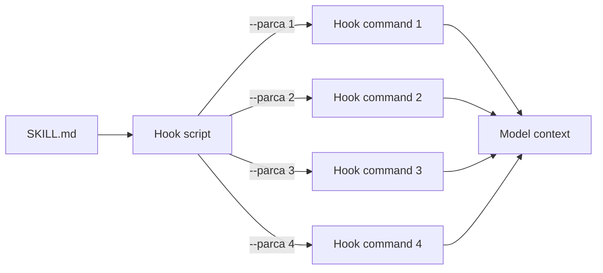

# Opus Orkestra

A working rule for Claude Code: the lead model never writes code itself, it splits the job across many narrow sub-agents, then verifies the result.

## Why

- **The lead's context stays on the big picture.** Reading files, writing code and running tests happen in sub-agents, so the main conversation keeps the plan, the decisions and the user's intent.
- **Parallelism.** Independent pieces of work run as separate agents at the same time, each with one narrow job.
- **Model choice per task.** Simple, well-bounded work goes to Sonnet; complex or ambiguous work goes to Opus.
- **A reviewer with fresh context.** A separate agent reviews the result without having seen how it was produced, so it is not anchored on the author's assumptions.
- **Two independent views.** For risky or uncertain calls, a second agent looks at the same question separately.

The full rules (limits between agents, flow, brief writing, communication with the user) live in [`skill/SKILL.md`](skill/SKILL.md). This README only summarizes them.

## How it works

Two parts work together:

1. **The skill**: [`skill/SKILL.md`](skill/SKILL.md) holds the complete rule text.
2. **A SessionStart hook**: [`hooks/opus-orkestra-sessionstart.py`](hooks/opus-orkestra-sessionstart.py) injects the rules into context at the start of every session, so the rule applies without the model having to remember to load the skill.

Claude Code caps a hook's additional context at 10,000 characters; beyond that only the first 2,000 characters reach the model. The rule text is longer than that, so the hook splits it at `## ` headings into up to 4 parts. Each part is delivered by its own hook command (`--parca 1` to `--parca 4`), and each stays under the limit.



## Install

Recommended: from the repository root run

```powershell
.\install.ps1 -Components orkestra
```

See the [root README](../../README.md) for details.

Manual install:

1. Copy `skill/SKILL.md` to `~/.claude/skills/opus-orkestra/SKILL.md`.
2. Add four commands under `SessionStart` in your Claude Code `settings.json`, replacing `<repo>` with the path of this repository:

```json
{
  "hooks": {
    "SessionStart": [
      {
        "hooks": [
          { "type": "command", "command": "python -I \"<repo>/packages/opus-orkestra/hooks/opus-orkestra-sessionstart.py\" --parca 1", "timeout": 15 },
          { "type": "command", "command": "python -I \"<repo>/packages/opus-orkestra/hooks/opus-orkestra-sessionstart.py\" --parca 2", "timeout": 15 },
          { "type": "command", "command": "python -I \"<repo>/packages/opus-orkestra/hooks/opus-orkestra-sessionstart.py\" --parca 3", "timeout": 15 },
          { "type": "command", "command": "python -I \"<repo>/packages/opus-orkestra/hooks/opus-orkestra-sessionstart.py\" --parca 4", "timeout": 15 }
        ]
      }
    ]
  }
}
```

## Configuration

The hook looks for `SKILL.md` in this order, first match wins:

1. `--skill <path>` command-line argument
2. `OPUS_ORKESTRA_SKILL` environment variable
3. `~/.claude/skills/opus-orkestra/SKILL.md`
4. `../skill/SKILL.md` (relative to the hook script, i.e. the copy in this repository)

## Turning it off

- If the user explicitly asks the model to switch the skill off, the rule stops applying for that session.
- To disable it permanently, remove the four SessionStart hook entries from `settings.json`, or run:

```powershell
.\install.ps1 -Uninstall -Components orkestra
```

## Tests

```powershell
python -m pytest packages/opus-orkestra/tests
```

## Note

The rules are currently written in Turkish. An English version is on the roadmap.

## Türkçe özet

Opus Orkestra, Claude Code için bir çalışma kuralıdır: şef model kod yazmaz, işi çok sayıda dar kapsamlı alt agent'a dağıtır ve sonucu kendisi doğrular. Amaç; ana bağlamı büyük resme ayırmak, paralel çalışmak, basit işe Sonnet karmaşık işe Opus seçmek, taze bağlamlı bir gözden geçirici ve çift görüş kullanmaktır.

Kurallar `skill/SKILL.md` içinde, SessionStart hook'u ise bunları her oturum başında bağlama enjekte eder. Hook çıktısı 10.000 karakteri aşarsa modele yalnız ilk 2.000 karakter gittiği için metin `## ` başlıklarından 4 parçaya bölünür ve 4 ayrı hook komutuyla verilir. Kurulum için kökten `.\install.ps1 -Components orkestra`; kaldırmak için `-Uninstall`. `SKILL.md` arama sırası: `--skill`, `OPUS_ORKESTRA_SKILL`, `~/.claude/skills/opus-orkestra/SKILL.md`, `../skill/SKILL.md`. Test: `python -m pytest packages/opus-orkestra/tests`. Kurallar şimdilik Türkçe; İngilizce sürüm yol haritasında.
