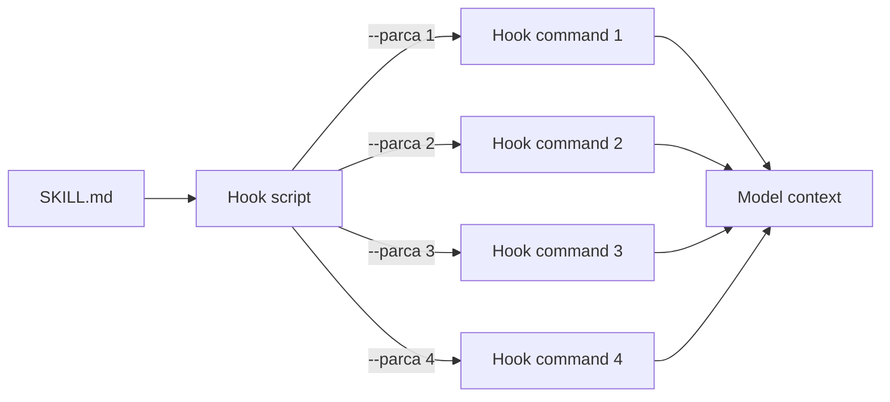

# Opus Orkestra

A working rule for Claude Code: the lead model never writes code itself, it splits the job across many narrow sub-agents, then verifies the result.

## Why

- **The lead's context stays on the big picture.** Reading files, writing code and running tests happen in sub-agents, so the main conversation keeps the plan, the decisions and the user's intent.
- **Parallelism.** Independent pieces of work run as separate agents at the same time, each with one narrow job.
- **Model choice per task, in three tiers.** Very easy, mechanical work goes to Sonnet; medium work and ordinary hard work (design, diagnosis, refactor, cross-component changes) go to Opus, hard work at high effort; Mythos is the exception, only for work that is very hard and needs new, inventive ideas (ties between Opus and Mythos resolve to Opus; the reviewer is always Opus; the dual-opinion pair is Opus + Fable). The Agent tool has no `mythos` value, so the lead reaches Mythos by leaving `model` unset on purpose: the sub-agent then inherits the lead's model. This needs a lead session that runs Mythos; otherwise the top tier is Opus.
- **Open-ended briefs for Mythos and Opus.** They get the goal, the facts, file ownership and a done-definition, never the method. Sonnet briefs are complete and one-way.
- **A reviewer with fresh context.** A separate agent reviews the result without having seen how it was produced, so it is not anchored on the author's assumptions.
- **Two independent views.** For risky or uncertain calls, a second agent looks at the same question separately.

The full rules (limits between agents, flow, brief writing, communication with the user) live in [`skill/SKILL.md`](skill/SKILL.md). This README only summarizes them.

## Context economy (core mode, ledger)

By default the hook no longer injects the whole rule book into every session. It injects a short
**core rule** ([`skill/CEKIRDEK.md`](skill/CEKIRDEK.md), ~3.6 KB instead of ~33 KB, about 90% less
fixed context per session). The full rules are read section by section when a code task actually
starts. Set `OPUS_ORKESTRA_MOD=tam` (or pass `--mod tam`) to get the old full injection back.

| | Before | Core mode |
| --- | --- | --- |
| Context injected at every session start | ~32.8 KB (3 parts) | ~3.6 KB (1 part) |
| Full rules | always in context | read when a code task starts, by section |

**Read diffs, write diffs, remember.** [`defter/defter.py`](defter/defter.py) is a per-repo context
ledger kept inside git (`.git/orkestra/defter.jsonl`, never committed, shared by worktrees):

```bash
defter yaz --dosya src/cart.py --ozet "Cart model: add/remove/total; prices in cents" \
           --kavram "Cart: items picked before checkout"
defter oku src/cart.py      # summary + only what changed since, uncommitted edits included
defter kavram               # domain concepts
defter ozetle --eski 20     # input for a haiku sub-agent to compress old cards
defter yaz --tur ozet --ozet "..."   # store the compressed summary; `defter oku` with no path shows it
defter temizle --tut 20     # keep the last 20 cards, the latest summary and each file's/concept's latest record
defter ozetle --eski 20 --yerel <ollama-model>   # experimental: summarise with a local model
```

`defter yaz` stores each file's content in git's object store, so `defter oku` can show the exact
diff since then; an unchanged file is not re-read at all. The core rule tells the lead and every
brief to use it, to edit with small replacements instead of rewriting files, and to return
`git diff --stat` instead of code. Adaptive effort (start low, raise one level on failure) is
described in the rules as experimental.

## How it works

Two parts work together:

1. **The skill**: [`skill/SKILL.md`](skill/SKILL.md) holds the complete rule text.
2. **A SessionStart hook**: [`hooks/opus-orkestra-sessionstart.py`](hooks/opus-orkestra-sessionstart.py) injects the rules into context at the start of every session, so the rule applies without the model having to remember to load the skill.

Claude Code caps a hook's additional context at 10,000 characters; beyond that only the first 2,000 characters reach the model. The rule text is longer than that, so the hook splits it at `## ` headings into up to 4 parts. Each part is delivered by its own hook command (`--parca 1` to `--parca 4`), and each stays under the limit.

If the installed `~/.claude/skills/opus-orkestra/SKILL.md` differs from the repo copy next to the hook (line endings and BOM ignored), the hook uses the repo copy, adds a note to the context and warns the user to refresh the install (`install.ps1 -Components orkestra`, or the macOS equivalent). Passing `--skill` or a valid `OPUS_ORKESTRA_SKILL` skips the comparison.



## Install

Recommended: from the repository root run

```powershell
.\install.ps1 -Components orkestra
```

See the [root README](../../README.md) for details.

Manual install:

1. Copy `skill/SKILL.md` to `~/.claude/skills/opus-orkestra/SKILL.md`.
2. Add four commands under `SessionStart` in your Claude Code `settings.json`, replacing `<repo>` with the path of this repository:

```json
{
  "hooks": {
    "SessionStart": [
      {
        "hooks": [
          { "type": "command", "command": "python -I \"<repo>/packages/opus-orkestra/hooks/opus-orkestra-sessionstart.py\" --parca 1", "timeout": 15 },
          { "type": "command", "command": "python -I \"<repo>/packages/opus-orkestra/hooks/opus-orkestra-sessionstart.py\" --parca 2", "timeout": 15 },
          { "type": "command", "command": "python -I \"<repo>/packages/opus-orkestra/hooks/opus-orkestra-sessionstart.py\" --parca 3", "timeout": 15 },
          { "type": "command", "command": "python -I \"<repo>/packages/opus-orkestra/hooks/opus-orkestra-sessionstart.py\" --parca 4", "timeout": 15 }
        ]
      }
    ]
  }
}
```

## Configuration

The hook looks for `SKILL.md` in this order, first match wins:

1. `--skill <path>` command-line argument
2. `OPUS_ORKESTRA_SKILL` environment variable
3. `~/.claude/skills/opus-orkestra/SKILL.md`
4. `../skill/SKILL.md` (relative to the hook script, i.e. the copy in this repository)

## Turning it off

- If the user explicitly asks the model to switch the skill off, the rule stops applying for that session.
- To disable it permanently, remove the four SessionStart hook entries from `settings.json`, or run:

```powershell
.\install.ps1 -Uninstall -Components orkestra
```

## Tests

```powershell
python -m pytest packages/opus-orkestra/tests
```

## Note

The rules are currently written in Turkish. An English version is on the roadmap.

## Türkçe özet

Opus Orkestra, Claude Code için bir çalışma kuralıdır: şef model kod yazmaz, işi çok sayıda dar kapsamlı alt agent'a dağıtır ve sonucu kendisi doğrular. Amaç; ana bağlamı büyük resme ayırmak, paralel çalışmak, modeli üç kademede seçmek (çok kolay işe Sonnet; orta ve sıradan zor işe Opus, zor işte yüksek eforla; Mythos istisnadır, yalnız çok zor ve yeni, özgün fikir gerektiren işe; Opus ile Mythos arasında kalırsa Opus), taze bağlamlı bir gözden geçirici (her zaman Opus) ve çift görüş (Opus + Fable) kullanmaktır. Agent aracında `mythos` değeri olmadığı için Mythos, `model` bilerek boş bırakılıp şefin modeli devralınarak verilir; şef Mythos değilse en üst kademe Opus'tur. Mythos'a ve Opus'a brief açık uçlu yazılır (amaç, olgular, dosya sahipliği, bitti tanımı; yöntem değil), Sonnet brief'i eksiksiz ve tek yönlüdür.

Kurallar `skill/SKILL.md` içinde, SessionStart hook'u ise bunları her oturum başında bağlama enjekte eder. Hook çıktısı 10.000 karakteri aşarsa modele yalnız ilk 2.000 karakter gittiği için metin `## ` başlıklarından 4 parçaya bölünür ve 4 ayrı hook komutuyla verilir. Kurulum için kökten `.\install.ps1 -Components orkestra`; kaldırmak için `-Uninstall`. `SKILL.md` arama sırası: `--skill`, `OPUS_ORKESTRA_SKILL`, `~/.claude/skills/opus-orkestra/SKILL.md`, `../skill/SKILL.md`. Test: `python -m pytest packages/opus-orkestra/tests`. Kurallar şimdilik Türkçe; İngilizce sürüm yol haritasında.
